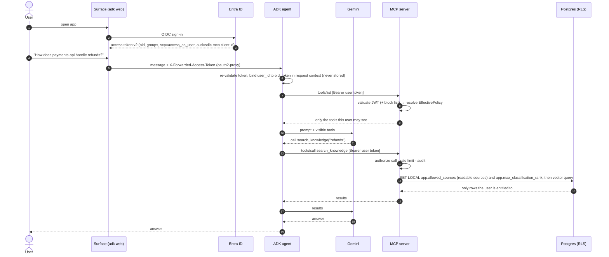
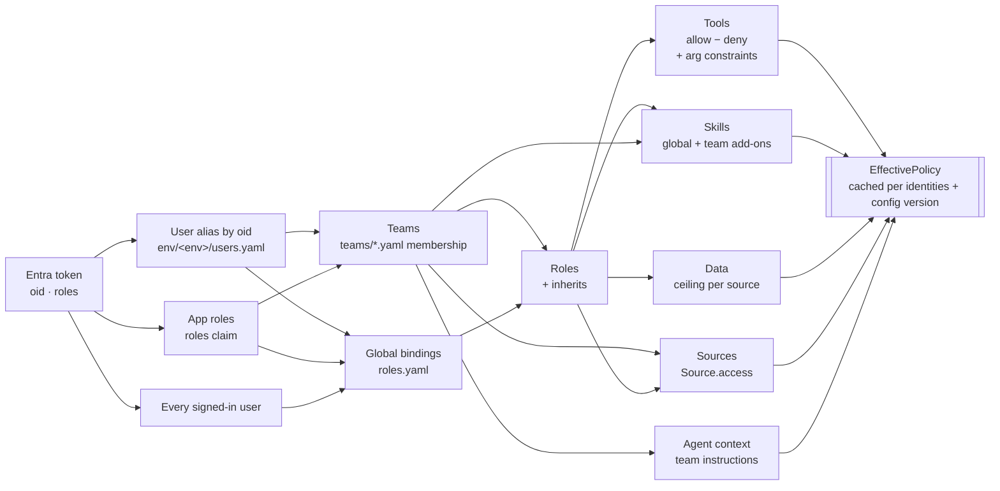
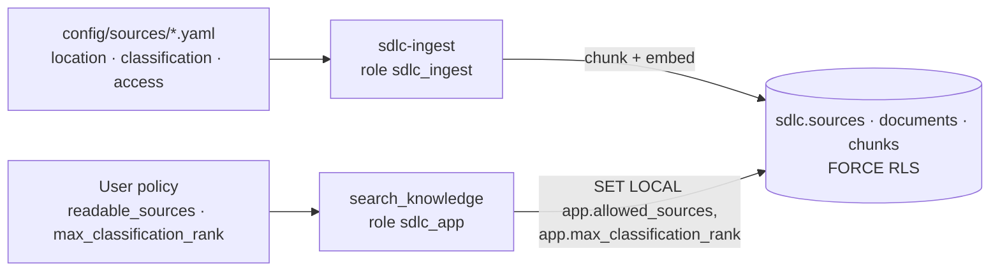
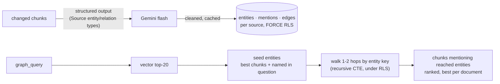
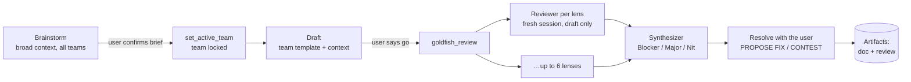
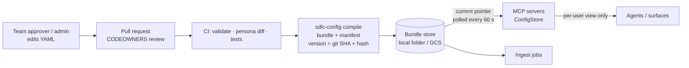

# Agentic SDLC — System Architecture

High-level view of the platform. For staged delivery, config syntax and exit gates, see
[version-00.md](plans/archive/version-00.md); current plan: [version-03.md](plans/version-03.md); what is built, per
component and with its status: [FEATURE_INVENTORY.md](FEATURE_INVENTORY.md).

Requirements and the component register now live in the knowledge bundle: [system context](../knowledge/system/context.md),
[requirements](../knowledge/requirements/index.md), [components](../knowledge/components/index.md). Where §1 or §3 below
disagree with the bundle, the bundle is right. All documents: [README.md](README.md).

## 1. What the system does

Engineers use an AI assistant for SDLC work: writing user stories, reviewing designs,
generating tests, reviewing code, and answering questions about their team's systems. The
assistant is a **Google ADK agent** built from **skills**, which are reusable instruction
packages. The skills, tools and team knowledge it can use all come from a central **MCP
server**.

Each user sees **only** the tools, skills and knowledge their Entra ID group membership
allows. This is called *selective disclosure*. Declarative YAML files in `config/` decide the
rules, and the MCP server enforces them, backed by Postgres row-level security.

## 2. System diagram

```mermaid
flowchart TB
    subgraph Users["Users (Entra ID sign-in)"]
        U1[Member / Approver / Admin]
    end

    subgraph Surfaces["User surfaces"]
        S1[CopilotKit chat /chat/ · AG-UI<br/>adk dev UI /dev-ui/<br/>behind oauth2-proxy]
        S2[Gemini Enterprise<br/>A2A /a2a]
        S3[Antigravity IDE<br/>direct MCP client]
    end

    Entra[(Microsoft Entra ID<br/>single IdP<br/>app roles)]

    subgraph AgentTier["Agent tier"]
        A1[ADK root agent<br/>agents/user_agent]
        A2[Future SDLC agents<br/>agents/&lt;name&gt;]
        LLM[[Gemini<br/>Vertex AI]]
    end

    subgraph ToolTier["Central MCP tier"]
        direction TB
        AUTH[AuthN<br/>Entra JWT validation<br/>libs/sdlc_auth]
        RES[Resolver<br/>groups → teams → roles<br/>→ EffectivePolicy<br/>libs/sdlc_config]
        ENF[Enforcement<br/>tools/list filter · call authz<br/>arg constraints<br/>libs/sdlc_policy]
        TOOLS[Tools<br/>whoami · skills · team context<br/>search_knowledge · graph_query<br/>artifacts · connected tools]
        AUD[(Audit log<br/>sdlc.audit JSON)]
        AUTH --> RES --> ENF --> TOOLS
        ENF -. every decision .-> AUD
    end

    subgraph Data["Data tier"]
        PG[(Postgres + pgvector<br/>chunks · embeddings<br/>entities · edges<br/>RLS by source + classification)]
    end

    subgraph Ingest["Ingest pipeline"]
        I1[Loaders → Chunkers →<br/>Embedders → Graph extractors]
        SRC[/Source artefacts<br/>local folders · git (GitHub, Bitbucket) · GCS<br/>Confluence · Jira (Cloud + DC)/]
    end

    subgraph Config["Config (git → versioned bundle)"]
        CFG[/config/*.yaml<br/>groups · roles · tools · skills<br/>teams · sources/]
        SK[/skills/*/SKILL.md/]
    end

    DS[[Downstream systems<br/>GitHub · Bitbucket · Jira · Confluence<br/>as the user, with their own PAT]]
    ART[(Artifact store<br/>file:// volume / gs:// bucket)]
    OTEL[(Traces<br/>OTLP → Jaeger locally)]

    U1 --> Surfaces
    U1 <-. sign-in .-> Entra
    S1 --> A1
    S2 --> A1
    S3 -- "bearer token" --> AUTH
    A1 -- "user bearer token" --> AUTH
    A1 <--> LLM
    A2 -. later .-> AUTH
    AUTH -. JWKS / Graph .-> Entra
    TOOLS -- "SQL with RLS context" --> PG
    TOOLS -- "user's connection<br/>after RBAC check" --> DS
    TOOLS -- "owner only" --> ART
    SRC --> I1 --> PG
    CFG -- bundle --> RES
    SK -- bundle --> TOOLS
    CFG -- Source.spec --> I1
    I1 <--> LLM
    A1 -. spans .-> OTEL
    TOOLS -. spans .-> OTEL
```

## 3. Components

| Component | Location | Responsibility |
|---|---|---|
| **Surfaces** | `ui/copilotkit`, external | Where users talk to the agent. The **CopilotKit chat** at `/chat/` (AG-UI to `/agui`; history, artifacts panel and viewer, Connections page) is the main surface; the ADK dev UI at `/dev-ui/`; **A2A** at `/a2a` (A2A 0.3, used by Gemini Enterprise since 2026-11-07); Antigravity (IDE; connects straight to MCP; verified with a dev token). |
| **Entra ID** | external | The single identity provider. Tokens carry `oid`, `upn`, `groups` and app `roles`. |
| **ADK agents** | `agents/` | Conversation and reasoning with Gemini. They discover skills and call tools through MCP, forwarding the **user's** token. They make **no** authorization decisions, never read `config/` and hold no DB credentials. Local agent tools: `goldfish_review` (isolated reviewers for the EGM document flow) and `set_active_team`. Tool results carry A2UI cards for A2A clients (built from the result, never by the model). Conversations are stored per user (see "Conversation storage"). |
| **MCP server(s)** | `mcp_servers/` | The single enforcement point. Validates tokens (and the block list), resolves the user's `EffectivePolicy`, filters what the user can see, authorizes and rate-limits every call, and audits it (with a `trace_id` when tracing is on). Also serves the `/connections/` and `/artifacts/` HTTP APIs behind the same checks. |
| **Shared libs** | `libs/` | `sdlc_auth` (identity), `sdlc_config` (config, resolver, bundles, document-flow defaults), `sdlc_policy` (authorization, rate limits), `sdlc_db` (RLS-scoped DB access, vector + keyword search, graph), `sdlc_web` (agent web app: user binding, AG-UI, A2A, threads, conversation retention), `sdlc_agent` (team context, Goldfish reviewers, A2UI cards), `sdlc_connectors` (host-allowlisted HTTP, providers, per-user secret store), `sdlc_secrets` (secret references), `sdlc_artifacts` (artifact content store + limits). |
| **Skills** | `skills/` | SKILL.md instruction packages. They hold content only; access is declared in `config/`. Naming: lowercase kebab-case, globally unique (global `skills/core/<name>/`, team add-ons `skills/teams/<team>/<name>/`, team instructions `skills/teams/<team>/AGENT_ADDENDUM.md`); folder = frontmatter `name` = config key. |
| **Config** | `config/` | YAML that declares groups, roles, teams, tools, skills, sources, rate limits and the block list. Served from the watched folder in dev, or from immutable, verified bundles (`sdlc-config compile`). |
| **Ingest** | `ingest/` | Reads source artefacts declared in `config/sources/` (local folders, git repositories on GitHub or Bitbucket at a pinned commit or tracked branch, GCS buckets, Confluence and Jira in Cloud and Data Center editions), chunks and embeds them, extracts a knowledge graph, and tags every row with `source_id` + `classification`. |
| **Postgres + pgvector** | `db/` | Vector search plus the knowledge graph (as edge tables). Row-level security is the last line of defense for data access. |
| **Observability** | compose profile `observability` | OpenTelemetry traces (agent, MCP server, Postgres) to Jaeger when `OTEL_EXPORTER_OTLP_ENDPOINT` is set; no prompts, responses, tokens or argument values in spans. |
| **CI** | `.github/workflows/ci.yml` | Lint, config validation + PR permission diff, tests on a pgvector service, Terraform checks. No secrets or cloud access. |

## 4. Request flow — a user asks a question



The security checkpoints in this flow are:
1. A request with no valid Entra token, or from a blocked user (`blocked.yaml`), gets 401.
2. Tools the user may not use are never listed, so the model can't even try them.
3. Every call is re-authorized, including its arguments (e.g. which repo), then rate-limited per user.
4. Postgres filters rows by the user's readable sources and classification ceiling, even if a tool has a bug.
5. Every allow or deny is audited with the config version and the rule that matched.

### Agent -> MCP connections and correlation

- **Headers per MCP call:** the agent's `McpToolset` uses `sdlc_auth.adk.agent_header_provider`, which sends
  `Authorization: Bearer <user token>` and `X-SDLC-Agent-Session: <ADK conversation id>`.
- **One MCP session per conversation:** ADK pools MCP client sessions (and caches tool lists) by the hash of
  those headers. Because the conversation id is one of them, the agent keeps **one MCP client session per
  (user token, conversation)**, not one per user token. Consequences:
  - conversations never share an MCP connection, even for the same user;
  - a little more connection setup (one `initialize` per conversation, and again when the token refreshes);
  - tool lists are fetched per conversation, so policy changes show up in new conversations immediately.
  - The per-turn invocation id is deliberately **not** a header: that would open a new MCP session every turn.
- **Server side is stateless:** with the current MCP protocol the client sends no `Mcp-Session-Id` and every
  request stands alone on the server. The "session" exists only on the client (ADK's pooled connection).
- **Correlating a conversation:** every `sdlc.audit` record carries
  - `agent_session_id`: the conversation (client-supplied, recorded when well-formed, never used for decisions);
  - `request_id`: one MCP request (a tool list or a tool call; shared by the records it produces and by the
    `sdlc.mcp` traceback of a crash);
  - `mcp_session_id`: only when a client sends `Mcp-Session-Id` (older protocol clients);
  - `trace_id`: when tracing is on. One agent turn is one trace across agent → MCP server → Postgres: the MCP
    client carries the trace context in the request's `_meta`, not in an HTTP header, so the one-session-per-
    conversation rule is untouched. Direct MCP clients (Antigravity) send no conversation id and start their own
    server-side traces.
  `docker compose logs core-mcp | grep <agent_session_id>` shows everything one conversation did.

## 5. Identity and authorization model



- **Identity** is the Entra `oid` plus Entra **app roles** (`roles` claim) and the optional users.yaml entry.
  Entra groups are not used (CH-0011): a `groups` claim is ignored. Entra is the only trusted issuer. Every signed-in user also matches `everyone: true`
  bindings, which grant only the `signed-in` basics (`ping`, `whoami`).
- **App roles** (version-03 P2 E1): `SDLC.User`, `SDLC.Admin`, `SDLC.<Team>.Member|Approver`
  (payments, platform, webapp) on `sdlc-mcp` (`entra_setup.ps1`), assigned to users on its enterprise app.
- **Direct members** (version-02 N10): for users without an app role assignment, `config/env/<env>/users.yaml`
  (git-ignored) adds users to teams (with team roles) and global roles. Admins list emails; `sdlc-config users sync`
  looks up each `oid` (read-only); the server matches tokens on `oid` only, never on an email claim, and an entry
  without an `oid` grants nothing. A user's policy is the union of their groups, app roles and users.yaml entry.
- **Teams** define who belongs, which roles each group gets, and team add-ons (extra skills, extra agent instructions, tool argument limits).
- **Roles** are reusable permission bundles. A role can inherit from another.
- **Platform and team roles** (CH-0009): global bindings give platform roles (`signed-in`, `viewer`, `admin`); team
  membership gives team roles (`member`, optional `approver`) that count **only in that team**
  (`approver@payments`). Inheritance stays in the same scope, and platform roles count in every team. So an
  approver-only add-on skill needs the approver role in its own team, and the classification ceiling is computed
  per source: the highest among the platform roles and the roles held in the source's owner team. A role is
  either a platform role or a team role, never both (validated).
- **Data access** is granted only by each source's own `access` block. The sensitivity ceiling comes from roles.
- **Deny wins**, and anything not explicitly allowed is denied.
- **Block list (E3):** `config/env/<env>/blocked.yaml` refuses listed users on every request, even with a valid
  token, from the next config reload; audited as `auth_failure` reason `blocked`.
- **Rate limits:** a platform baseline plus team limits (overall and per tool; the most generous of the user's
  teams wins), per user and minute, checked after authorization; refusals are audited as `rate_limited`.
- **Argument limits** (e.g. allowed repos) are unioned across the teams that set them; a team that sets none
  never widens access; `unconstrained` roles (admin) skip them.
- **Enforcement (Stage 3, tools):** the MCP server filters `tools/list` to the caller's policy and authorizes every
  `tools/call` (tool + arguments) before it runs; each decision is audited with the config rule that matched.
  `whoami(explain=true)` shows a user their own policy; admins use `config_explain`; `sdlc-config diff` shows
  per-persona permission changes on every config change.

### Data access (Stage 5)

Tables, columns, indexes, roles and policies: [DATABASE_SCHEMA.md](DATABASE_SCHEMA.md).



- **Two checks, one source of truth.** The resolver turns `Source.access` (teams, roles, groups, `everyone`) into the
  user's granted sources (a source can have its own Entra group, so readers need no team), takes the highest `max_classification` across the user's roles, and keeps the
  granted sources whose **current** classification is at or below that ceiling (`readable_sources`). The
  MCP server searches only those, and Postgres RLS filters every row on the same values (set per
  transaction by `sdlc_db.scoped()`) plus each row's own classification stamp. A bug in tool code cannot
  widen access beyond what RLS allows.
- **Classification changes:** raising a source's classification in config takes effect on the next
  request (it leaves `readable_sources`), with no re-ingest and no DB writes by the MCP server. Lowering
  it takes effect after ingest re-stamps the rows; until then the stricter stamp applies (fail closed).
- **Fail closed:** without the RLS context a query returns no rows, for every role including the table
  owner (`FORCE ROW LEVEL SECURITY`). No database role is a superuser or has BYPASSRLS.
- **Roles:** `sdlc_owner` owns the schema and runs migrations; `sdlc_app` (MCP server) can only SELECT;
  `sdlc_ingest` writes. Agents get no database credentials at all.
- **Classification** is stamped on every document and chunk at ingest from the Source config; changing a
  source's classification and re-running ingest re-stamps existing rows.
- **Embeddings:** `gemini-embedding-2` at 768 dimensions on Vertex AI (`platform.yaml` `knowledge.embedding`),
  RETRIEVAL_DOCUMENT for chunks and RETRIEVAL_QUERY for questions; HNSW cosine index with iterative scan so
  RLS filtering still returns k results.
- Ingest runs on demand (`docker compose run --rm ingest run --all`) and skips unchanged files by content hash.
  Sources: local folders, git repositories read at a pinned commit or a tracked branch (never the working tree; e.g.
  `sdlc-platform` = this repository on GitHub, tracking `main`), GCS buckets (the sample sources), Confluence and Jira
  (natively restricted items are never ingested). Remote calls go through the host allowlist; on GCP the ingest job
  runs on a Cloud Scheduler schedule.
- **Keyword search (version-03 P11):** `chunks.content_tsv` (`simple` configuration, GIN index) finds exact
  identifiers that embeddings miss (Jira keys, error codes, config keys, file and function names). Only
  identifier-like terms are searched (digits, `_ . - /` or camelCase; plain words and all-caps acronyms are not).
  `search_knowledge` ranks by cosine similarity plus a keyword rank bonus; `graph_query` fuses the vector and
  keyword lists (RRF) to pick its starting entities. Results say `via: vector | keyword | both`. Switch:
  `platform.yaml` `knowledge.keyword_search`. Runs under the same RLS context as the vector query.
- **Document types:** UTF-8 text files (Markdown by headings, Python/Terraform by definitions, everything else by
  line windows) and **PDFs** (H10): the text layer is read locally; pages without text (scans) are read by Gemini
  only for sources that set `pdf.ocr: gemini`. PDF chunks follow the bookmarks and record **page** ranges, so
  answers cite `file.pdf, p. N`. PDFs are parsed only in the ingest job, never in the MCP server or agent.

### Knowledge graph (Stage 6)



- **Per-source graph.** An entity belongs to one source; the same name in two sources is two rows with the same
  `key`. The walk joins by key, and RLS hides rows from sources the caller can't read, so a connection through an
  unreadable source simply does not exist for that caller. There are no global entities that could leak.
- **Extraction** runs at ingest (Gemini structured output, temperature 0, types from the Source config). Model output
  is untrusted: only allowed types and relations between extracted entities are stored. Results are cached by chunk
  content, so re-ingesting costs model calls only for changed text.
- **`graph_query`** (viewers and up) returns documents plus the entities and relations it walked; `search_knowledge`
  (viewers and up) has no graph step (vector + keyword only). Both run entirely under the caller's RLS context.
- **Measured value:** on the sample corpus and on this repository (`tests/evals`), `graph_query` beats
  `search_knowledge` only through returning one result per document; its graph re-ranking adds nothing measurable
  yet. Its value today is the structured entities/relations in the answer.

### Artifacts (version-03 P5)

Documents the agent saves for a user (designs, reviews, user stories, reports; text only, 1 MiB, 50 per user).
**Owner only:** the owner is the token `oid`, never a tool argument, and anyone else (admins included) gets
"artifact not found". Metadata in `sdlc.artifacts` under owner RLS (`sdlc_db.owner_scoped`; the only table `sdlc_app`
may write, no UPDATE); content in `SDLC_ARTIFACT_STORE` (`file://` volume locally, `gs://` bucket on GCP) under
`artifacts/<oid>/<id>`, deleted after `SDLC_ARTIFACT_RETENTION_DAYS` (7). Tools `save/list/read/delete_artifact`;
browser downloads through the MCP `/artifacts/` API (attachment, `nosniff`, CSP sandbox). **Versions:**
`save_artifact(replaces=<id>, base_version=<n>)` adds the next version of the same document and refuses when `n` is not
the latest; rows are immutable, the id and link stay stable, older versions stay readable. The chat's artifact viewer
shows numbered lines and a Markdown preview; line comments are sent to the agent with "Attach to chat". Team sharing
(F3) is not built.

### EGM document flow (version-03 P10)

For document work only, after the [Elephant-Goldfish Model](https://egm.dev/): the agent (Elephant) runs the
`egm-brainstorm` skill (questions → options → a **brief** the user confirms) and then `egm-document-flow` (draft →
"review with Goldfish?" → review → resolve → save `<name>.md` + `<name>-review.md` as artifacts).



- **Reviewers are isolated:** one nested ADK run per lens with an empty state and only the draft; each loads its lens
  with `load_skill` and may check claims with `search_knowledge` / `graph_query`, all through MCP **as the user**
  (a lens the user can't see is reported `unavailable`). Audit records keep the chat's `agent_session_id`.
- **Lenses are skills** tagged `goldfish-lens`: four defaults plus `lens-structure` / `lens-style` opt-in; teams add
  their own (e.g. `payments-pci-lens`).
- **Team customization changes behaviour, never permissions:** typed team skills (tags `goldfish-lens`,
  `brief-questions`, `doc-template`), `addons.flows.document` defaults per document type (lenses, required lenses,
  template, brief), and caps that may only lower `platform.yaml` `flows.document`. `get_agent_context` serves them as
  data; they apply once the team is **locked** by the confirmed brief (`resolve_team` suggests it from hints).

### A2A and A2UI (version-03 P4)

- **A2A** (`/a2a`, A2A 0.3 JSON-RPC, public card at `/.well-known/agent-card.json`): callers send
  `Authorization: Bearer <Entra token>` through oauth2-proxy (an API route: 401, no login redirect). The user id is the
  token `oid`, the token stays request-scoped, client state and non-text parts are dropped, and another user's task or
  context answers "not found" / "unknown context". One A2A context = one session in the same store as the chat.
  Gemini Enterprise is registered against GCP dev (Entra authorization-code flow).
- **A2UI cards** (v0.9 standard catalog) are built deterministically from tool results (citations, `whoami`,
  connected tools) by `sdlc_agent.a2ui_cards` and sent to A2A clients as `application/json+a2ui` DataParts. The model
  never writes or sees them. The CopilotKit chat keeps its own compact renderers.

### Conversation storage (agent sessions)

ADK sessions hold the conversation history, including answers built from retrieved (possibly
confidential) knowledge. The store is chosen by `SDLC_SESSION_SERVICE_URI`; the user-binding
middleware keeps every user to their own sessions whatever the store.

**Current choice (local development, H9, 2026-09-27):** SQLite on a Docker volume that only the
agent container mounts (`sqlite:////data/sessions.db`, volume `agent-sessions`), conversations idle
for more than `SDLC_SESSION_RETENTION_DAYS` (7) are deleted with their events at startup and daily.

**GCP (version-01 M8, 2026-10-30): Vertex AI Agent Engine sessions.** One reasoning engine per
environment, used only as a session store (`infra/gcp/sessions.tf`, no deployed code, no memory
bank), in the deployment region. The agent gets
`SDLC_SESSION_SERVICE_URI=agentengine://projects/<p>/locations/<region>/reasoningEngines/<id>`
(full resource name only: the model location is `global`, the engine is regional) and
`sdlc_web.sessions` sets a TTL of `SDLC_SESSION_RETENTION_DAYS` on every new session, so retention
counts from the start of a conversation. Agents still hold no DB credentials; the app service
account reaches the engine with `roles/aiplatform.user`. Conversations survive restarts and
redeploys, which also removes the single-instance limit of the in-memory store.

The options stay open; they were weighed as follows:

| Option | How | Pros | Cons / conditions | Fits |
|---|---|---|---|---|
| In memory | `memory://` (default outside compose) | Nothing stored | Lost on every restart | tests, throwaway runs |
| **SQLite on an agent-only volume** (current) | `sqlite:////data/sessions.db` + retention job | No DB credentials for agents; no new service; survives restarts | One instance only (file lock); volume backup is manual | local dev; single-instance staging |
| Separate Postgres database | `postgresql+asyncpg://…` to a dedicated `sdlc_sessions` DB and role that can reach nothing else | Scales out; standard ADK `DatabaseSessionService`; backups with the DB | Agents would hold DB credentials: an explicit, narrow exception to the "agents get no DB credentials" rule (needs a decision + CLAUDE.md change); asyncpg driver; retention via SQL job | self-hosted multi-instance |
| Session API via the MCP server | Custom ADK `BaseSessionService` calling MCP tools; the MCP server stores sessions per `oid` | Agents stay credential-free and scale out; server-side audit of history access | Custom code in the agent path; extra latency per turn; not a standard ADK store | multi-instance without agent credentials |
| **Vertex AI Agent Engine sessions** (GCP) | `agentengine://projects/…/reasoningEngines/<id>` (full resource name) | Managed, scales, IAM via the service identity; the store Gemini Enterprise uses | GCP only (deferred with Stage 7); TTL/retention configured in Agent Engine; data residency by region | GCP staging/prod, Gemini Enterprise |

Switching is configuration plus infrastructure (URI, volume or database, retention), not agent
code, except for the MCP session API. Whatever the store: retention must be set, content capture in
traces stays off, and the store is never readable by other workloads.

## 6. Config lifecycle



Only MCP servers (and ingest, for source definitions) read config. Agents and users get an
already-resolved, per-user view through MCP tools. A service with no valid config at startup
refuses to serve. A bad reload keeps the last good version. Rollback means moving the
`current` pointer back.

Today: local development serves the watched `config/` folder (bundles optional:
`sdlc-config compile --activate`, `SDLC_CONFIG_BUNDLES`, verified on every load). On GCP (version-02 N13) the
MCP service and the ingest job read bundles from `gs://<config store bucket>/bundles/<env>/` (mounted
read-only) and the MCP server polls `current` every `SDLC_CONFIG_POLL_SECONDS` (60); the user publishes with
`gcp_deploy.ps1 -Step config` and rolls back with `-ConfigVersion <v>`. CI validates config and shows the
permission diff on pull requests. Pub/Sub reload and CI promotion are not built (version-03 P3).

## 7. Environments and endpoint exposure

| Environment | Where it runs | How users reach it | TLS / DNS |
|---|---|---|---|
| **Development, local** (config env `local`) — **the current phase** | Docker Compose on a developer machine | **Both**: `localhost` (4180 UI, 8080 MCP) for the developer, and a **Cloudflare Tunnel** for testers: `app-sdlc-dev.shaheenks.co.in`, `mcp-sdlc-dev.shaheenks.co.in` | Localhost: plain HTTP (Entra allows `http://localhost` callbacks). Tunnel: TLS ends at Cloudflare's edge (Universal SSL); outbound-only connector, no inbound ports |
| **Higher environments** (staging, prod) | GCP (Stage 7): Cloud Run / load balancer | **Hosted directly** on their own public hostnames. **No tunnel and no localhost access** | DNS **CNAME** to the platform endpoint (Cloud Run domain mapping or load balancer) and a **managed certificate** (Google-managed or Cloudflare edge + origin certificate) |
| **Development on GCP** (config env `dev`; version-01 M7, deployed 2026-10-28) | GCP `sdlc-demo-env01` / `asia-southeast1`, Cloud Run | Cloud Run's own `https://sdlc-app-dev-<project number>.asia-southeast1.run.app` and `sdlc-mcp-dev-…` URLs (temporary exception: custom hostnames later) | Google-managed TLS on `*.run.app`; no DNS records |
| **Staging, prod** | Designed (Stage 7), not deployed; staging dropped for version-03 (P1, 2026-11-07) | — | — |

Rules that follow from this:
- **Dev needs both paths.** Two oauth2-proxy instances share one Entra client: `oauth2-proxy`
  with a fixed `http://localhost:4180/oauth2/callback`, and `oauth2-proxy-public` with a fixed
  `https://app-sdlc-dev…/oauth2/callback`, `Secure` cookies and reverse-proxy mode. Both
  callbacks are registered on the dev Entra client.
- **Higher environments** run a single public oauth2-proxy (or the platform's equivalent) with
  that environment's HTTPS callback only. **No `localhost` redirect URIs** and no Azure CLI
  pre-authorization in their Entra registrations (gap E6); `MCP_PUBLIC_URL` is the environment's
  own MCP hostname.
- **Hostnames:** `<service>-sdlc-<env>.shaheenks.co.in` (for example `app-sdlc-stg…`,
  `mcp-sdlc-stg…`); prod may drop the suffix (`app-sdlc.shaheenks.co.in`). Keep names one level
  below the zone so a single wildcard certificate covers them.
- **Hostnames are configuration, not code:** `SDLC_APP_HOST`, `SDLC_MCP_HOST` and
  `MCP_PUBLIC_URL` per environment. Nothing in code may assume `localhost` or a tunnel.

Details for dev exposure: [CLOUDFLARE_TUNNEL.md](guides/CLOUDFLARE_TUNNEL.md). GCP design, diagrams and deployment runbook:
[GCP_DEPLOYMENT.md](guides/GCP_DEPLOYMENT.md).

## 8. Deployment views

| Aspect | Development: local + Cloudflare Tunnel (current phase) | GCP (dev since version-01 M7; staging/prod later) |
|---|---|---|
| Agent | `user-agent` container (`sdlc-agent-web`: ADK web app + Entra user binding), reached via `oauth2-proxy` on `localhost:4180` or publicly via Cloudflare Tunnel (host connector) → `oauth2-proxy-public` (localhost:4181) at `https://app-sdlc-dev.shaheenks.co.in` | Cloud Run service `sdlc-app-<env>`: oauth2-proxy ingress container + agent sidecar (`:8000`, `/agui`, `/a2a`) + CopilotKit chat app sidecar (`:3000`, `/chat/`), 1 instance; Gemini Enterprise reaches `/a2a` with bearer tokens |
| MCP server | `core-mcp` container (`localhost:8080`; public `https://mcp-sdlc-dev.shaheenks.co.in/mcp` via Cloudflare Tunnel) | Cloud Run service `sdlc-mcp-<env>` (public, stateless, scales out; Entra token is the gate) |
| Database | `postgres` container (pgvector, `127.0.0.1:5432`) | Cloud SQL for PostgreSQL 17 + pgvector via the Cloud SQL connector only (no authorized networks; private IP later); roles/RLS by the `sdlc-db-setup` job |
| Ingest | CLI in container (on demand, profile `ingest`; `.git` mounted read-only for git sources) | Cloud Run Job `sdlc-ingest-<env>`, optionally on a Cloud Scheduler schedule; reconcile job `sdlc-reconcile-<env>` for stored PATs |
| Config | bind-mounted `config/`, file-watch reload (local bundles optional) | GCS bundle + `current` pointer in the config store bucket, polled every 60 s (version-02 N13); published with `-Step config` |
| Artifacts | `file://` volume on `core-mcp` | GCS artifact bucket (lifecycle 7 days), `objectUser` for the MCP service account only |
| Conversations | SQLite on the agent-only `agent-sessions` volume, 7-day retention | Vertex AI Agent Engine sessions (version-01 M8), retention from conversation start (see "Conversation storage") |
| Tracing | Jaeger (profile `observability`, UI on `localhost:16686`) | Cloud Trace exporter (`cloud_trace = true`, version-02 N4) |
| Secrets | `.env` | Secret Manager |
| Model | Gemini API key or ADC | Vertex AI via each workload's service account (no key files) |
| Identity | Entra test tenant: groups, app roles, users.yaml | Same Entra apps and tenant as local dev (groups, app roles, users.yaml in the bundle); federated credentials and Entra apps in Terraform are parked (version-03 P2 E4–E6) |
| Endpoints | `localhost:4180` / `:8080` + tunnel `app-/mcp-sdlc-dev.shaheenks.co.in` | Direct public hostnames per environment: DNS CNAME + managed certificate; no tunnel |

## 9. Growth path

The target design (2026-11-11) is [designs/workflow-platform.md](designs/workflow-platform.md). It
covers four workflow classes (plan and design, build and test, deploy and maintain, implementation),
event intake, enrichment and delivery, workflow identity, and the knowledge extensions. This section
stays the as-built view.

The platform starts as one agent, one MCP server, one ingest CLI and one database; that is
a starter component in each area (`agents/user_agent`, `mcp_servers/core_mcp`, `ingest/bootstrap`). It grows by adding **sibling components**: more
SDLC agents (next: `ci_agent` / `ops_agent` with workload identity and an event gateway, version-03 P6),
specialised MCP servers (e.g. a knowledge server), write tools with UI confirmation (P7) and more ingest
loaders (SharePoint, P8; local folders, git, GCS, Confluence and Jira exist today). All of them share `libs/` and the same `config/` policy, so identity and
selective disclosure stay consistent as the system expands.
