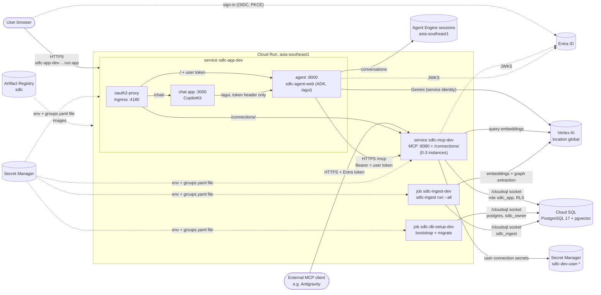
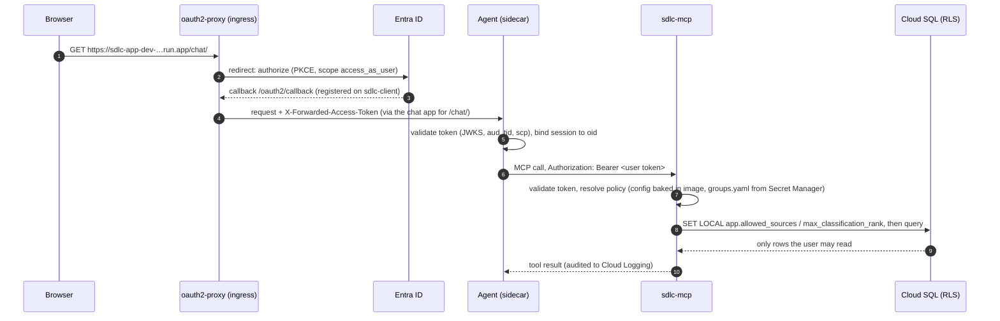
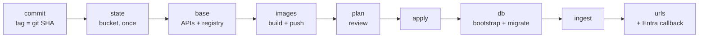

# GCP deployment

How agentic-sdlc runs on Google Cloud: the design, the resources Terraform creates, how identity and
secrets flow, and how to deploy, update and tear down an environment.
Related: [ARCHITECTURE.md](ARCHITECTURE.md) §7–8 (environments), [infra/README.md](../infra/README.md)
(files), [version-01.md](plans/version-01.md) §5 and §10 (M7–M8 progress), [version-00.md](plans/version-00.md)
Stage 7 (original decisions).

## 1. Status

**GCP is the `dev` environment** (version-01 M7, 2026-10-28): project **`sdlc-demo-env01`**, region
**`asia-southeast1`** (`infra/gcp/dev.tfvars`, state `gs://sdlc-demo-env01-tf-state` prefix `dev`,
`config/env/dev/groups.yaml`). **The user runs Terraform and `gcp_deploy.ps1`.**

| Item | State |
|---|---|
| Services `sdlc-app-dev` (oauth2-proxy + agent + CopilotKit chat app) and `sdlc-mcp-dev` | Deployed 2026-10-28 (images `d3c13dbd3493`, Terraform at `bffe7d8`); sign-in, `/chat/` and `/dev-ui/` checked in the browser |
| Job `sdlc-db-setup-dev` (schema + RLS) | Ran successfully |
| Job `sdlc-ingest-dev` | **Not run**: the dev sources are updated first (version-01 §10.3) |
| Entra dev callback on `sdlc-client` | Registered |
| Agent Engine sessions (`sessions.tf`, version-01 M8) | **In Terraform, not applied yet**: `images` + `plan` + `apply` |

**Not yet in Terraform** (version-01 §10.3, reviewed later): `blocked.yaml` from Secret Manager (no block list on GCP
today), source credentials as Secret Manager secrets with accessor for the jobs service account, Cloud Scheduler for
ingest, the user-secret reconcile job, OTLP export to Cloud Trace.

An earlier staging attempt in `cloud-migration-agent` / `asia-south1` (2026-09) is abandoned: ignore its state bucket,
registry and images. The `staging.*` files stay for a later staging environment.

## 2. Decisions

| Topic | Decision | Why |
|---|---|---|
| Project / region | `sdlc-demo-env01`, `asia-southeast1` (Singapore) | Dedicated demo project (2026-10-28). Vertex model calls use location `global`; Agent Engine sessions are regional |
| Environment | `dev` (`SDLC_ENV=dev`, `config/env/dev/`) | GCP dev next to local + tunnel dev; staging and prod later |
| Endpoints | Cloud Run's own `*.run.app` URLs | No DNS or load balancer cost. A temporary exception to the rule "higher environments use a CNAME + managed certificate" |
| Entra | Dev callback added to the existing `sdlc-client` | Simplest; a per-environment client app is the enterprise path (plan gaps E4/E5) |
| Database | Cloud SQL PostgreSQL 17 + pgvector, Enterprise edition, `db-g1-small`, zonal | Smallest tier that fits HNSW indexes; same engine as local |
| Conversations | Vertex AI Agent Engine sessions (version-01 M8) | Managed, scales out, agents keep no DB credentials; Gemini Enterprise uses the same store later |
| Deploy tooling | Terraform + PowerShell script (Windows PowerShell 5.1 or `pwsh`) | Windows dev machine; the same script can run in Linux CI with `pwsh` |

Organization policy (checked read-only in 2026-09 for the earlier project; re-check if `sdlc-demo-env01` sits in a
different organization):

| Constraint | Effective value | Consequence |
|---|---|---|
| `iam.allowedPolicyMemberDomains` | Restricted to the org's domains | No `allUsers` invoker binding: public services set Cloud Run **`invoker_iam_disabled`** |
| `run.managed.requireInvokerIam` | Not enforced | `invoker_iam_disabled` is allowed |
| `sql.restrictAuthorizedNetworks` | Enforced | Fits the design: Cloud SQL is reached only through the connector |
| `sql.restrictPublicIp` | Not enforced | Public IP (for the connector) is allowed; private IP is a later hardening |

## 3. Architecture on GCP



- **`sdlc-app-<env>`**: three containers in one service. oauth2-proxy is the ingress container (only port 4180 is
  exposed): it signs the user in with Entra and forwards requests with the user's access token. Routes: `/chat/` →
  CopilotKit chat app, `/connections/` → the MCP service, everything else → the agent. The agent and chat app bind
  `0.0.0.0` (Cloud Run's startup probes do not connect over loopback) but cannot be reached from outside. The
  agent re-validates the token and binds every session to the user's `oid`, as locally.
  `OAUTH2_PROXY_PASS_HOST_HEADER=false` (Cloud Run routes by Host), so the agent gets its public origin in
  `SDLC_ALLOWED_ORIGINS` for ADK's cross-origin guard.
- **Conversations**: Agent Engine sessions (`sessions.tf`), deleted `session_retention_days` (7) after they start.
  Locally: SQLite on an agent-only volume. `app_max_instances` stays 1 until a conversation is checked to survive
  a new revision. The agent has no DB credentials.
- **`sdlc-mcp-<env>`**: public and stateless, so it scales out (0–3 instances). Every request must carry a valid
  Entra token for the sdlc-mcp API; policy, RLS context and audit work exactly as locally. It also serves the
  Connections API and is the only workload that reads or writes users' connection secrets.
- **Jobs**: `sdlc-db-setup` creates roles, schema and RLS (`sdlc-db bootstrap` + `migrate`); `sdlc-ingest` builds
  the knowledge store and graph from the sources baked into the image (`config/`, `samples/`).
- **Public without `allUsers`**: both services set `invoker_iam_disabled` (see §2). Cloud Run does not check Google
  IAM; authentication is Entra's job (oauth2-proxy, token validation).
- **Cloud Run reserves paths ending in `z`**: `/healthz` returns Google's 404 from outside; probes reach the
  container directly. Check health with the startup probe or logs.

### Sign-in and a request



## 4. Resources (Terraform, `infra/gcp`)

| File | Resources | Notes |
|---|---|---|
| `main.tf` | `google_project_service` (Run, Cloud SQL Admin, Secret Manager, Artifact Registry, Vertex AI, IAM, Resource Manager), Artifact Registry `sdlc` | Locals compute the deterministic URLs `https://<service>-<project number>.<region>.run.app` before the services exist, so each service is configured with its own public URL (`MCP_PUBLIC_URL`, OAuth redirect). Enable `cloudresourcemanager.googleapis.com` by hand before the first plan |
| `sql.tf` | Instance `sdlc-<env>` (PG 17, Enterprise, `db-g1-small`, zonal, 10 GB autoresize, backups on, `ENCRYPTED_ONLY`), database `sdlc`, user `postgres` | Public IP for the connector only, no authorized networks |
| `secrets.tf` | Generated passwords (`admin`, `owner`, `app`, `ingest`), cookie secret; 7–8 secrets + versions `sdlc-<env>-*` | Entra client secret, optional Graph secret and `groups.yaml` come from local git-ignored files |
| `iam.tf` | Service accounts `sdlc-<env>-mcp`, `-app`, `-jobs`; project roles; per-secret accessor bindings; custom role `sdlcUserSecrets_<env>` | See §5 |
| `run.tf` | Services `sdlc-mcp-<env>`, `sdlc-app-<env>`; jobs `sdlc-db-setup-<env>`, `sdlc-ingest-<env>` | Secrets as env vars (`version = latest`); `groups.yaml` as a file at `/app/config/env/<env>/`; Cloud SQL socket at `/cloudsql` |
| `sessions.tf` | Agent Engine `sdlc-sessions-<env>` (`google_vertex_ai_reasoning_engine`, version-01 M8) | Session store only (no deployed code, no memory bank); the agent gets its full resource name in `SDLC_SESSION_SERVICE_URI` |
| `outputs.tf` | `app_url`, `oauth_callback`, `mcp_url`, `session_engine`, `registry`, `sql_connection_name`, `jobs` | |
| `<env>.tfvars`, `<env>.gcs.tfbackend` | Project, region, env, tier, deletion protection; state bucket + prefix | No tenant IDs in either |

Variables worth knowing: `app_max_instances` (1), `session_retention_days` (7), `gcs_source_buckets` (buckets read
by `gcs` sources: the jobs service account gets `roles/storage.objectViewer` on each), `entra_authority_host`.

## 5. Identity, access and secrets

| Workload | Service account | Project roles | Secrets it can read |
|---|---|---|---|
| `sdlc-mcp` | `sdlc-<env>-mcp` | Cloud SQL Client, Vertex AI User, `sdlcUserSecrets_<env>` (condition: names starting `sdlc-<env>-user-`) | `pg-app-password`, `groups-yaml`, `entra-graph-secret` (if set); users' connection secrets |
| `sdlc-app` | `sdlc-<env>-app` | Vertex AI User (Gemini and Agent Engine sessions) | `oauth2-cookie`, `entra-client-secret` |
| jobs | `sdlc-<env>-jobs` | Cloud SQL Client, Vertex AI User; Storage Object Viewer on `gcs_source_buckets` | `pg-admin-password`, `pg-owner-password`, `pg-app-password`, `pg-ingest-password`, `groups-yaml` |

- **No key files**: Vertex AI, Agent Engine, Secret Manager and Cloud SQL use each workload's service identity.
  The local ADC file mount does not exist on GCP.
- **Database roles** are the same as locally: `sdlc_owner` (migrations), `sdlc_app` (MCP, read-only),
  `sdlc_ingest` (writes); none can bypass RLS, and every data table uses FORCE ROW LEVEL SECURITY. Cloud SQL's
  `postgres` is `cloudsqlsuperuser`, not a real superuser: `sdlc-db bootstrap` handles that (it grants itself
  membership of `sdlc_owner` to create the schema, only re-sets passwords on existing roles) and **fails if any
  role can bypass RLS**.
- **User connection secrets** (version-01 M6): one secret per user, `sdlc-<env>-user-<hash of oid>`, written and
  read only by the MCP server after the policy check. Whether the IAM condition also covers `secrets.create` is
  unverified until the first Connections save on GCP.
- **Secrets** live in Secret Manager. Their values are also in the Terraform state (GCS bucket with uniform access
  and no public access) and in a saved plan file (git-ignored, deleted by `apply`).
- **Tenant-specific values** (tenant ID, app IDs, client secret, group IDs) are read from `.env` and
  `config/env/<env>/groups.yaml` at deploy time and never committed.
- **Entra**: the dev callback `https://sdlc-app-dev-<project number>.asia-southeast1.run.app/oauth2/callback` is
  registered on `sdlc-client` next to the local and tunnel callbacks. Sign in on that deterministic host: the OAuth
  redirect and cookie domain use it, not the hashed `status.url`.

## 6. Configuration on GCP

- `config/` and `skills/` are baked into the images at build time (one config version per release);
  `SDLC_ENV=dev`; file watching is off (`SDLC_CONFIG_WATCH=false`). The only environment-specific file,
  `groups.yaml`, is stored in Secret Manager and mounted as a file. **A config change (including sources) needs
  `images` + `plan` + `apply`.**
- Later (Stage 7b): config bundles in `gs://sdlc-config-<env>/` with a `current` pointer, Pub/Sub reload,
  last-known-good, rollback by pointer flip. The bundle format, verification, `activate` and rollback are built
  and tested locally (`libs/sdlc_config/bundles.py`, `SDLC_CONFIG_BUNDLES`).

## 7. Deployment



From the repo root, in PowerShell (Docker Desktop running, `gcloud` signed in, Terraform installed):

```powershell
.\scripts\gcp_deploy.ps1 -EnvName dev -Step state    # state bucket (once per project)
.\scripts\gcp_deploy.ps1 -EnvName dev -Step base     # APIs + Artifact Registry
.\scripts\gcp_deploy.ps1 -EnvName dev -Step images   # build + push mcp/agent/ingest/ui, mirror oauth2-proxy
.\scripts\gcp_deploy.ps1 -EnvName dev -Step plan     # writes infra/gcp/dev.tfplan; review it
.\scripts\gcp_deploy.ps1 -EnvName dev -Step apply    # first time ~10-15 min (Cloud SQL)
.\scripts\gcp_deploy.ps1 -EnvName dev -Step db       # sdlc-db bootstrap + migrate on Cloud SQL
.\scripts\gcp_deploy.ps1 -EnvName dev -Step ingest   # sources: chunks, embeddings, graph
.\scripts\gcp_deploy.ps1 -EnvName dev -Step urls     # app URL, MCP URL, OAuth callback
```

- **Image tag = commit SHA.** `images` and `plan` refuse to run with uncommitted changes. To re-plan without
  rebuilding, pass a pushed tag: `-ImageTag <sha>`.
- **Confirmation**: `base` and `apply` ask before changing anything unless `-AutoApprove`.
- **Apply deploys the saved plan file**: re-plan after every Terraform change.
- **Why a mirror for oauth2-proxy**: Cloud Run pulls only from Artifact Registry or Docker Hub, and oauth2-proxy is
  published on quay.io.
- **Updates**: commit → `images` → `plan` → `apply`. Schema changes: add a migration, then `db`. Content changes:
  `ingest` (unchanged files and cached graph extractions cost nothing).

## 8. Verification

On dev, with the test users (payments developer, platform developer, payments lead, admin, and an account with no
sdlc groups):

1. Sign in at the `app_url`: `/chat/` (CopilotKit) and `/dev-ui/` (ADK) load.
2. `whoami` shows each user's own teams and roles; tool lists differ per persona.
3. Skills and team context per user (`list_skills`, `get_agent_context`).
4. After ingest: `search_knowledge` and `graph_query` return only each user's sources; the payments lead also sees
   the confidential incidents.
5. Conversations (after the M8 apply): start a chat, deploy a new revision, and check the conversation is still
   listed in `/dev-ui/` for the same user and not for another.
6. Connections: connect a GitHub token on `/chat/connections` (first save on GCP also checks the IAM condition on
   `secrets.create`), then read a file through the chat.
7. Audit records in Cloud Logging (`jsonPayload.event` for `tool_call`, `tools_list`, `auth_failure`,
   `connection_change`): `gcloud logging read 'resource.labels.service_name="sdlc-mcp-dev"' --limit 50`.

## 9. Cost (rough, per month)

| Item | Estimate |
|---|---|
| Cloud SQL `db-g1-small`, 10 GB SSD, backups | ~US$25–35 (runs continuously) |
| Cloud Run services and jobs | ~US$0–5 (scale to zero; requests only) |
| Agent Engine sessions | Expected to be small at dev volume; check the current Agent Engine pricing page before raising usage |
| Secret Manager, Artifact Registry storage, state bucket | < US$1 |
| Vertex AI (embeddings, flash calls for the sample corpus and tests) | cents |

Teardown removes everything created by `apply` (`deletion_protection = false` in `dev.tfvars`):

```powershell
cd infra/gcp; terraform destroy -var-file=dev.tfvars   # needs the same TF_VAR_* as plan
```

## 10. Next

- Pending items of version-01 §10.3: dev sources + ingest, block list on GCP, source secrets, reconcile job,
  Cloud Scheduler, Cloud Trace.
- Scale `sdlc-app` out: check conversations survive a new revision and that cookie sessions in oauth2-proxy are
  enough, then raise `app_max_instances`.
- Custom hostnames (`<service>-sdlc-<env>.shaheenks.co.in`): CNAME + Google-managed certificate (load balancer or
  domain mapping), then drop the `*.run.app` exception.
- GCS config bundles + Pub/Sub reload, CI deploy stages (validate, diff and tests already run on GitHub Actions;
  add build → plan → apply).
- A shared rate-limit store when `sdlc-mcp` runs more than one instance (limits are per instance today).
- Per-environment Entra client app, certificates or federated credentials instead of client secrets (plan gaps E4,
  E5, E8); Cloud SQL private IP.
