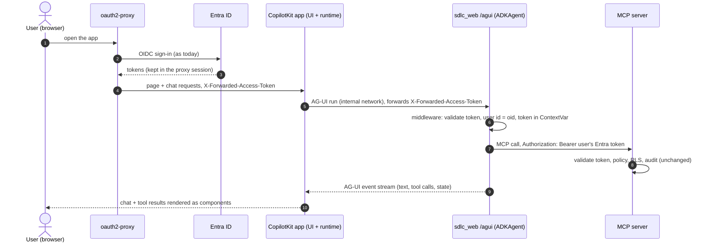
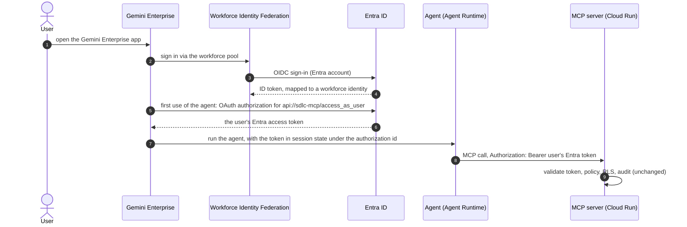

# Agentic SDLC — Implementation Plan version-01

Follows [version-00.md](version-00.md) (Stages 0–9 and the local backlog H1–H10). Architecture: [../ARCHITECTURE.md](../ARCHITECTURE.md);
database: [../DATABASE_SCHEMA.md](../DATABASE_SCHEMA.md); GCP design: [../GCP_DEPLOYMENT.md](../GCP_DEPLOYMENT.md).

## Goals

1. **More knowledge sources:** Google Cloud Storage buckets; remote git repositories on **GitHub** and
   **Bitbucket**; **Confluence** and **Jira**, each in **Atlassian Cloud and Data Center** editions.
2. **AG-UI web app:** users chat with the SDLC agents in a **CopilotKit** web app that talks to the agent over the
   **[AG-UI protocol](https://adk.dev/integrations/ag-ui/)**, signing in with their **Entra ID account** through
   oauth2-proxy as today. Every tool call still runs as the user under the same policy; MCP tool results render as UI
   (citations, entities) instead of plain text.
3. **Act on behalf of the user:** users connect their own **Confluence, Jira, GitHub and Bitbucket** accounts once;
   MCP tools then call those systems **as the user**, with the user's credential kept in **Secret Manager** and read
   only by the MCP server after the policy check. Global (service) secrets are resolved at runtime the same way.
4. **Gemini Enterprise is deferred** to a later version. Its design is kept in §6 so the AG-UI work stays compatible
   with it (both are front ends to the same agent and MCP server).

## Progress

| Milestone | Status | Notes |
|---|---|---|
| M0 — Source framework | ✅ Built (2026-10-28) | `ingest/loaders` (`sdlc_loaders`: `SourceItem`, `Loader`, registry, `local_folder`/`git` loaders, `HttpClient`), `libs/sdlc_secrets` (env + Secret Manager REST, 5-min cache), migration `004_item_metadata` (`documents.title/url`, `sync_state`), `title`/`url` in search results, `knowledge.allowed_hosts`, `spec.credentials` references. Format converters and per-type `spec` blocks come with their connectors (M1–M4) |
| M1 — Remote git (GitHub, Bitbucket) | ✅ Built (2026-10-28); no live check | `provider` (github / bitbucket-cloud / bitbucket-dc), host-scoped auth header via git's environment, branch tracking at FETCH_HEAD (fixes stale branches in the cache), incremental reads via `git diff`, deep links per provider, `SDLC_INGEST_CACHE`, `.env.sources` for the ingest container |
| M2 — GCS buckets | ✅ Built (2026-10-28); no live check | `type: gcs` (`gs://bucket/prefix/`), JSON API with ADC / service identity, downloads only changed generations, deletions from the listing, object links; Terraform `gcs_source_buckets` → `roles/storage.objectViewer` per bucket for the jobs SA |
| M3 — Confluence (Cloud + DC) | ✅ Built (2026-10-28); no live check | One REST v1 CQL implementation for both editions (v2 has no CQL); every run lists versions/ancestors/read restrictions, restricted pages and descendants skipped + deleted (fail closed); bodies only for changed versions; storage format → Markdown; PDF attachments; Basic (`email:token`) or Bearer (PAT); credentials never sent to cross-host redirects |
| M4 — Jira (Cloud + DC) | ✅ Built (2026-10-28); no live check | JQL sources; Cloud REST v3 `search/jql`, DC REST v2; every run lists `updated` + `security` (issue security → skipped + deleted); full fields only for changed issues; one Markdown document per issue (ADF / wiki markup converted, no people fields); issue links in the text for the graph |
| M5 — AG-UI web app (CopilotKit) | ✅ Done (2026-10-28); browser check passed on localhost and the tunnel | `/agui` in `sdlc_web` (spike, §3.3) + `ui/copilotkit` (Next.js 16, CopilotKit 1.79.0) at `/chat/` behind oauth2-proxy; header allowlist, no thread storage in Node, citation cards, CSP; CI job |
| M6 — User connections (on behalf of the user) | ✅ Done (2026-10-28); GitHub + Bitbucket Cloud verified live; Jira/Confluence and all DC editions not tested (no instance) | `libs/sdlc_connectors` (providers, per-user secret store: file/Secret Manager, service), `connections.yaml`, `/connections/` API on the MCP server, Connections page `/chat/connections`, tools `jira_get_issue`, `confluence_get_page`, `github_get_file`, `bitbucket_get_file`; Terraform custom role on the user-secret prefix |
| M7 — GCP dev (was: staging) | ✅ Deployed and checked (2026-10-28); ingest deferred | Project `sdlc-demo-env01`, `asia-southeast1`, env `dev` (§5.1). Services ready, sign-in, `/chat/` and `/dev-ui/` checked in the browser; `sdlc-db-setup-dev` succeeded (schema + RLS); **ingest not run: sources config to be updated first**; Entra dev callback registered |
| M8 — Hardening, evals, docs | 🔄 In progress (2026-10-30) | Scope in §10: Agent Engine conversation store on GCP, connection-tool gaps, docs as-built, exit-gate checklist. Sources, live checks, block list and secret management moved to the pending list (§10.3) |
| Deferred — Gemini Enterprise | ⏸ Later version | WIF sign-in, Agent Runtime, Gemini Enterprise authorization (§6) |

**Next:** M8 (§10). The dev sources update and the `sdlc-ingest-dev` run are pending (§10.3), as are live checks of Jira/Confluence
Cloud and every Data Center edition (§4.9) and the reconcile job (§4.7). Commits (branch `version-01`): M0 `91218d2`, M1 `9f8b324`,
M2 `b7e72b7`, M3 `28ebf3b`, M4 `50ef071`, M5 spike `6c94829`, M5 app `6c0d85b` + fix `ccdc8f5`, M6 part 1 `6dad7e6` + part 2
`5df7946`, M7 retarget `0b6f0a9` + fixes `bffe7d8`, `0b795a5`. Connectors are tested against local repositories and fake APIs (recorded
response shapes) only; the live checks are listed in §7.

## Decisions (2026-10-17)

| Topic | Decision |
|---|---|
| Atlassian editions | **Both** Cloud and Data Center/Server: one connector per product with an `edition: cloud \| datacenter` switch |
| Access model | **Config access only**, as today: each space, project, repository or bucket prefix is a `Source` with `access` + `classification`. Native ACLs are **not** mirrored; items with native restrictions are **excluded at ingest** (§2.6) |
| GCP | **Resume in version-01**: Stage 7a (M7; retargeted to the **dev** environment on 2026-10-28, §5.1) after the AG-UI app (M5) and user connections (M6) work locally. Connectors are built and tested locally first (M0–M4) |
| User front end (2026-10-28) | **AG-UI + CopilotKit** in version-01, served by `sdlc_web` behind oauth2-proxy (Entra). adk web stays the developer UI (`/dev-ui/`). **Gemini Enterprise deferred** to a later version (§6): it needs an org admin, a workforce pool and licences, while AG-UI needs nothing beyond today's Entra setup |
| Global secrets (2026-10-28) | Config **names** a secret (`env:` or `secret:`), `libs/sdlc_secrets` resolves it at runtime (`.env` locally, Secret Manager API on GCP) with a short cache, so rotation needs no redeploy. Secrets needed at startup (DB passwords, Entra values, `groups.yaml`, `blocked.yaml`) stay Cloud Run env/file mounts (§4.2) |
| User secrets (2026-10-28) | **One Secret Manager secret per user holding a JSON directory** of that user's connections (50–100 users, ≤ 5 connections each). Read and written **only by the MCP server**, after the policy check; writes serialised per user (§4.3) |
| On-behalf access (2026-10-28) | Tools for Confluence, Jira, GitHub and Bitbucket run **as the user** with the user's own **personal access token (PAT only; no OAuth flows)**. Our policy decides whether the tool may run; the provider's native permissions then apply on top. Ingested knowledge keeps the config-only access model above. Never falls back to a service credential |
| Gemini Enterprise sign-in (deferred) | **WIF with Entra ID as OIDC provider** when it is picked up: users sign in with Entra accounts; no Google accounts to manage |
| Agent memory | Off, as assessed on the `future-assessment` branch. AG-UI conversations use the existing `SDLC_SESSION_SERVICE_URI` store and retention; no memory service |
| Live checks (2026-10-28) | M1–M4 are built and tested without network (local bare repositories, fake APIs). Checks against real GitHub, Bitbucket, GCS, Confluence and Jira instances are **deferred** until test instances and tokens exist (§7, §8); they are part of the M8 exit gate |
| Confluence API (2026-10-28) | REST v1 CQL search for **both** editions instead of Cloud REST v2 (v2 has no CQL). Revisit if Atlassian retires the v1 search on Cloud (§9) |
| RAG database | Postgres-compatible on GCP (Cloud SQL, as designed in Stage 7a). Spanner stays an open option, not part of version-01 |

## 1. Source framework (M0) — built

Ingest reads every source through a loader. Loaders live in the sibling component **`ingest/loaders/`** (package
`sdlc_loaders`); `ingest/bootstrap` keeps the pipeline (chunk, extract, embed, write). Details per module:
[../../ingest/loaders/README.md](../../ingest/loaders/README.md).

- **Loader contract** (`base.py`): `items(cursor) -> Iterator[SourceItem]`, `all_ids()` (incremental loaders),
  `cursor` (saved after the run), `details` (run report). `SourceItem` = stable `path` (the item id: a file path,
  `PAY/123456`, `PAY-123`), text or PDF bytes, `content_hash`, `media_type` (`text/plain`, `text/markdown`,
  `application/pdf`), `title`, `url`, `restricted`. Factories take `(source, LoaderContext)` (repo root, cache root,
  secret resolver, allowed hosts) and are registered in `LOADERS` (`registry.py`).
- **Pipeline:** streams items (large sources are not held in memory); skips unchanged items by content hash; a changed
  title/URL with unchanged content updates metadata only (no re-embedding); `restricted` items are never written and a
  stored copy is deleted; incremental loaders report every existing id (`all_ids`) so deletions are still found; if a
  loader fails, nothing is written or deleted for that source. The cursor is saved only after a run without errors
  (failed items are retried); `--force` ignores it. `text/markdown` items use the Markdown chunker in `auto` mode.
- **Cursor model:** git stores the commit (plus location and a hash of the globs); GCS, Confluence and Jira store a map
  of item id → generation / version / `updated`. Every run lists ids and versions (cheap, no content) and downloads
  only what changed; any change of location, globs or query means a full read.
- **Citations:** migration `004_item_metadata` adds `documents.title` and `documents.url`; `search_knowledge` and
  `graph_query` return them when present. Links are per document (no `#L10-L20` line anchors; results already carry
  `lines`/`pages`).
- **Sync state:** the same migration adds `sync_state(source_id, cursor jsonb, last_synced_at)`: ingest-only, RLS
  enabled + forced, no `sdlc_app` grant, rows cascade with their source.
- **Credentials:** a Source names its secret, never contains it: `credentials: { env: NAME }` or
  `{ secret: name }`, resolved at run time through `libs/sdlc_secrets` (§4.2). Only types that read credentials accept
  the field (`CREDENTIAL_SOURCE_TYPES`: git, confluence, jira). Locally the values live in a git-ignored `.env.sources`
  that only the ingest container loads; on GCP the ingest job reads Secret Manager (`SDLC_SECRETS_BACKEND=gcp`).
- **Host allowlist (SSRF guard):** `platform.yaml` `knowledge.allowed_hosts` (exact names or one wildcard label,
  e.g. `*.atlassian.net`); empty = no remote sources. Checked by config validation for every `https` location and by
  `sdlc_connectors.http.HttpClient` (moved from `sdlc_loaders` in M6) on every request and every redirect. Credentials in URLs are refused.
- **HttpClient:** 429/5xx and connection errors retried with exponential backoff and `Retry-After` (capped);
  timeouts; credentials from a per-request callable, sent only to the request's own host (never to a cross-host
  redirect such as a pre-signed download URL); one secret re-read after a 401.
- **Schema:** `config/schemas/source.schema.json` lists the types `local_folder`, `git`, `gcs`, `confluence`, `jira`.
  Type-specific keys (`TYPE_OPTIONS` in `sdlc_config/loader.py`, exposed as `SourceDef.options`) are refused on other
  types. Every new source still needs persona-matrix `data_rows` and a CODEOWNERS rule.
- **Runtime settings:** `SDLC_INGEST_CACHE` (git clone cache; the ingest image uses `/tmp/sdlc-ingest-cache`, since
  it runs as `nobody`), `SDLC_SECRETS_*` (§4.2).

## 2. Connectors — built (M1–M4), not yet checked against live systems

### 2.1 Remote git: GitHub and Bitbucket (M1)
```yaml
spec:
  type: git
  location: https://github.com/<org>/<repo>.git         # bitbucket.org/<ws>/<repo>.git | https://<host>[/<ctx>]/scm/<proj>/<repo>.git
  provider: github                                     # github | bitbucket-cloud | bitbucket-dc (required for https)
  ref: main                                            # branch/tag (tracked) or a full SHA (pinned)
  credentials: { secret: github-acme-token }           # optional for public repositories
```
- Partial bare clone into the ingest cache. The token is sent as `http.<scheme>://<host>/.extraHeader` in git's
  environment (`GIT_CONFIG_*`), so only the repository host gets it and it never appears in argv or the URL;
  credential helpers and prompts are disabled. Header per provider: GitHub `Basic x-access-token:<token>`,
  Bitbucket Cloud `Basic x-token-auth:<token>`, Bitbucket DC `Bearer <token>`. A failed clone/fetch drops the cached
  secret.
- Recommended tokens: GitHub **fine-grained PAT** (Contents: read) or a GitHub App installation token (expires after
  an hour, so it needs a minting step: not built), Bitbucket Cloud **repository access token**, Bitbucket DC **HTTP
  access token**.
- **Branch tracking:** remote repositories are read at `FETCH_HEAD`, so a tracked branch is always its current commit
  (this also fixed a version-00 bug where a cached bare clone kept the first-cloned branch commit). Pinned SHAs stay
  pinned (keep them for eval corpora such as `sdlc-platform`).
- **Incremental:** the next run reads only paths changed since the stored commit (`git diff`); a missing old commit
  (rewritten history), a new location or changed globs mean a full read.
- **Links:** GitHub `/<org>/<repo>/blob/<commit>/<path>` (also GitHub Enterprise hosts), Bitbucket Cloud
  `/<ws>/<repo>/src/<commit>/<path>`, Bitbucket DC `/projects/<PROJ>/repos/<repo>/browse/<path>?at=<commit>`.
- Validation: provider required for https and refused otherwise; URL shape per provider; credentials only for https.

### 2.2 Google Cloud Storage (M2)
```yaml
spec:
  type: gcs
  location: gs://<bucket>/<prefix>/
  include: ["**/*.md", "**/*.pdf"]                     # relative to the prefix
```
- GCS JSON API (fixed endpoint `storage.googleapis.com`) through `HttpClient`, with ADC and the read-only scope: the
  ingest service identity on GCP, gcloud ADC locally. No keys and no `credentials`.
- Paged listing under the prefix; an object is downloaded only when its **generation** differs from the cursor (CRC32C
  is not used: a new generation already means new content). Objects over the size limits are skipped from the
  listing size, before download. Links point to `storage.cloud.google.com/<bucket>/<object>`.
- Terraform: `gcs_source_buckets` grants the jobs service account `roles/storage.objectViewer` on each listed bucket.

### 2.3 Confluence (M3)
```yaml
spec:
  type: confluence
  edition: cloud                                         # cloud | datacenter
  location: https://<site>.atlassian.net/wiki            # DC: https://<host>[/<context>]
  space: PAY
  cql: "label = runbook"                                 # optional narrowing
  attachments: [pdf]                                     # optional: PDF attachments of selected pages
  credentials: { secret: confluence-pay }                # Cloud "<email>:<api token>" (Basic); DC PAT (Bearer)
```
- **One implementation for both editions:** REST v1 content search with CQL (`/rest/api/content/search`, following
  `_links.next`). The plan's Cloud REST v2 was not used: v2 has no CQL. Atlassian is retiring parts of v1 on Cloud, so
  the live check must confirm this endpoint first (§9).
- Every run lists all selected pages with **version, ancestors and read restrictions** (no bodies): adding a
  restriction does not change a page's version, so restrictions and deletions must be re-checked every run. Bodies
  (`body.storage`) are fetched only for pages whose version changed.
- Pages become Markdown: `# Title`, a `Path: A > B > Title` line from the ancestors, then the storage format converted
  (headings, lists, tables, code macros, panels, links; images and macro parameters dropped). Item id
  `<SPACE>/<page id>`, link from `_links.base` + `_links.webui`.
- PDF attachments (`attachments: [pdf]`) of allowed pages only, via the H10 path; id
  `<SPACE>/<page id>/attachments/<id>`. Cloud downloads redirect to `api.media.atlassian.com`: add it to
  `allowed_hosts` (credentials are not sent there).
- Validation: edition, space and credentials required; no `include`/`exclude`; Cloud location must be
  `https://<site>.atlassian.net/wiki`.

### 2.4 Jira (M4)
```yaml
spec:
  type: jira
  edition: cloud                                         # cloud | datacenter
  location: https://<site>.atlassian.net                 # DC: https://<host>[/<context>]
  jql: "project = PAY AND issuetype in (Incident, Bug, Story)"   # no ORDER BY
  fields: [summary, description, status, priority, components, labels, issuelinks, comment]   # optional
  credentials: { secret: jira-pay }                      # Cloud "<email>:<api token>"; DC PAT
```
- Cloud: REST v3 enhanced search `/rest/api/3/search/jql` (`nextPageToken`; rich text in ADF). DC: REST v2
  `/rest/api/2/search` (`startAt`; wiki markup). Both are converted to Markdown.
- Every run lists the matching issues with only `updated` and `security`; full fields are fetched (in batches of
  `key in (...)`) only for issues whose `updated` changed.
- One document per issue, id = key (`PAY-123`), title `PAY-123: <summary>`, link `<location>/browse/PAY-123`: facts
  (type, status, priority, resolution), components, fix versions, labels, issue links (`is caused by PAY-7`),
  description, optional comments. **People fields (assignee, reporter, comment authors) are never included.** Issue
  links and components are in the text, so graph extraction (entity types per source) picks them up.
- Validation: edition, jql and credentials required; no `ORDER BY`; no `include`/`exclude`; Cloud location must be
  `https://<site>.atlassian.net`; `fields` from a fixed list that has no people fields.

### 2.5 Classification and access
- Each Source keeps one classification and one `access` block. Split by sensitivity with several sources (e.g.
  `payments-confluence` internal, `payments-incidents-jira` confidential), exactly as for folders today.

### 2.6 Native restrictions (security rule) — built
Because access is decided by config only, content that its owners restricted inside the tool must never reach a wider
audience:
- **Confluence:** pages with read restrictions on the page **or any ancestor** are skipped. When the search response
  does not include a page's restrictions, the page is asked for directly; restrictions that still cannot be read
  count as restricted (fail closed). Attachments follow their page.
- **Jira:** issues with an **issue security level** are skipped, also when the level appears between the listing and
  the full fetch. (An instance without issue security returns no `security` value: treated as not restricted.)
- **Private repositories / buckets:** the whole source is governed by its `access`; no per-file restrictions exist.
- Restricted items are checked on **every** run (not only changed ones); a stored copy of an item that became
  restricted is deleted. They are counted in the run report (`restricted=`), never their content. A source can't opt
  out of this in version-01; mirroring native ACLs remains a later option (Stage 9 `inherit_from_source`).

## 3. AG-UI web app with CopilotKit (M5)



### 3.1 Components (built)
- **Backend:** `/agui` in `libs/sdlc_web` (`agui.py`, `ag_ui_adk` `ADKAgent` + `add_adk_fastapi_endpoint`) around the
  agent named by `SDLC_AGUI_AGENT` (compose: `bootstrap`; empty = off). Behind the existing middleware: token
  validation, block list, ContextVar token path, plus `current_oid()` and AG-UI body sanitising. adk web keeps working.
- **Frontend:** `ui/copilotkit/` (Next.js 16.4.1, React 19.2.9, `@copilotkit/runtime` + `react-core` 1.79.0 v2 API,
  `@ag-ui/client` 1.0.2; exact pins). Compose service `ui-copilotkit` (internal :3000, not published). oauth2-proxy has
  two upstreams: **`/chat/` → the app**, everything else → the agent; both proxy instances (localhost, tunnel), so no
  new Entra callback. `/chat/api/` is an API route for the proxy (401 instead of a login redirect).
- **Runtime (server side):** `CopilotRuntime` with one `HttpAgent` to `SDLC_AGUI_URL` (internal
  `http://agent-bootstrap:8000/agui`), `forwardHeaders: { allow: ["x-forwarded-access-token"] }` (tested: cookies,
  browser `Authorization`, `x-forwarded-for` and other headers are not forwarded).
- **`PassThroughAgentRunner` (finding):** CopilotKit's default `InMemoryAgentRunner` keeps every thread in one
  process-wide map keyed only by thread id and replays it on `connect` (and can list threads). The Node layer does not
  authenticate users, so that would let one user read another's conversation. The app uses a runner that stores
  nothing and replays nothing (tested); `/info` reports all thread endpoints off.
- **Generative UI:** `search_knowledge` / `graph_query` render as citation cards (title, link, source, lines/pages,
  heading, graph badge, entities), `whoami` as an identity panel. Rendering only (no frontend tools); links only
  `http(s)`; CSP `connect-src 'self'` (no third-party calls from the browser). Telemetry off (CopilotKit, Next).
- **Next.js basePath:** route handlers get the URL without `/chat`; the route puts it back before the CopilotKit
  handler routes on it.
- **Known limitations:** after a page reload the chat starts empty (history is kept per user in the agent's session
  store but not yet loaded back into the UI: `/agents/state` can feed it later); the UI has no thread list.

### 3.2 Security requirements
1. **User id = the token's `oid`.** `ADKAgent` defaults the user id to the thread id; set `user_id_extractor` to read
   the `oid` bound by the middleware for this request. A thread/session belongs to one `oid` (the same ownership check
   the middleware does for adk web sessions).
2. **The token is never stored.** Do not use `extract_headers=["authorization"]` or similar: it copies headers into
   saved session state. The token travels only in the request ContextVar (confirmed by the spike: the run task
   inherits it).
3. **The token never reaches browser JavaScript.** It stays in oauth2-proxy and is added by the proxy; the CopilotKit
   runtime forwards only that header to `/agui` on the internal network (`forwardHeaders: { allow:
   ["x-forwarded-access-token"] }`).
4. **Client state is untrusted.** `RunAgentInput.state` is merged into session state, so the middleware strips the
   token key and every `temp:`, `app:` and `user:` key, and replaces any client `userId` with the `oid` (built);
   `allow_scoped_state_keys` stays off.
5. **Frontend tools are UI only.** CopilotKit actions defined in the browser run outside the MCP server and its
   policy, so they may only render, navigate or ask for confirmation. Anything that reads data or changes something
   is an MCP tool. Human-in-the-loop approval in the UI is UX, never authorization.
6. **No memory, persistent sessions.** `use_in_memory_services=False` with the `SDLC_SESSION_SERVICE_URI` session
   service and its retention; `save_session_to_memory_on_cleanup=False`; no memory service.
7. **Both dev paths work:** `localhost:4180` and `app-sdlc-dev` via the tunnel (both oauth2-proxy instances route the
   UI and keep their callbacks). Hostnames come from config, never hard-coded.
8. **Tracing and audit unchanged:** one agent turn is one trace; the conversation id still travels as
   `X-SDLC-Agent-Session`, so there is one MCP session per (user token, conversation).

### 3.3 Spike results (2026-10-28)
Built: `libs/sdlc_web/src/sdlc_web/agui.py` (`mount_agui`), enabled with `SDLC_AGUI_AGENT=<agent folder>`; the
middleware gained `current_oid()` and AG-UI body sanitising. Tested in `tests/web/test_agui.py` with a scripted test
agent (`tests/support/agui_agents/probe`: a fake model calls one tool that records what it sees), no LLM.

| Question | Result |
|---|---|
| `ag_ui_adk` with our ADK | **Works:** `ag-ui-adk` 0.11.0 (`ag-ui-protocol` 1.0.0) with `google-adk` 2.10.0. It pulls in a PyPI `asyncio` 4.0.0 that is an empty placeholder (metadata only; the standard library module still loads) |
| Token reaches tool calls (req. 2) | **Yes:** `ADKAgent.run` starts the agent with `asyncio.create_task` inside the request, so the task copies the request context; the probe tool sees the caller's token via `get_user_token` and nothing is put in state |
| User id = `oid` (req. 1) | **Yes:** `user_id_extractor` reads `current_oid()` (ContextVar set by the middleware; fails closed outside a request). A client `userId` is ignored. Sessions are keyed by (thread, user): another user with the same thread id gets their own session |
| `/agents/state` | `add_adk_fastapi_endpoint` also registers an experimental **`POST /agents/state`** (thread state + message history). Behind the middleware and with the extractor, it answers only for the caller: another user asking for the same thread id never sees its history (tested) |
| Client state (req. 4) | Sanitised by the middleware (tested: forged token, `temp:`, `user:`, `app:` keys dropped; ordinary keys kept) |
| CopilotKit header forwarding (req. 3) | From the CopilotKit v2 runtime docs (not yet run): the runtime clones the agent per request and by default forwards `authorization` and `x-*` headers minus a built-in denylist (proxy/CDN headers). Use **allowlist mode** `forwardHeaders: { allow: ["x-forwarded-access-token"] }`: only the proxy's token header reaches `/agui` (no cookies, no other headers). Server-set agent headers win over forwarded ones. To verify in the app build |

Decisions for the build: keep `/agui` on the agent container (same middleware, same session store via
`create_session_service_from_options`, ag_ui_adk's cleanup neither deletes sessions nor saves to memory); the
CopilotKit app uses `@copilotkit/runtime/v2` (`CopilotRuntime` + `createCopilotRuntimeHandler`, `HttpAgent` from
`@ag-ui/client` pointing at the internal `/agui` URL) with the allowlist above. Check how the runtime's
`InMemoryAgentRunner` keeps thread state (it should hold nothing beyond what the browser already has).

### 3.4 Browser check — passed (2026-10-28)
Sign in at `http://localhost:4180/chat/` as a test user (and `https://app-sdlc-dev…/chat/` with the tunnel profile): ask
"who am I?" (identity panel shows your teams/roles), ask a knowledge question (citation cards), check the MCP audit log
shows your `oid`, and a second test user in a private window gets their own view.
Result: works as expected on both paths. Fixed on the way: Next.js redirected `/chat/` to `/chat`, which the proxy
routes to the agent (404); the app now sets `skipTrailingSlashRedirect` and the agent redirects a bare `/chat` to
`/chat/`. Use a test user, not the tenant admin, for these checks (a lingering admin session skips the login page).

## 4. User connections and secrets (M6)

Users connect their own Confluence, Jira, GitHub and Bitbucket accounts once. MCP tools then call those systems **as the
user**, so the provider's native permissions apply on top of our policy. Agents and the model never see a credential.

### 4.1 Two kinds of secrets

| | Global | Per user |
|---|---|---|
| What | Connector tokens for ingest, Graph fallback secret | The user's personal access tokens (PATs), one per connection |
| Declared in | Source `credentials` | Nothing per user: the connection types come from `config/connections.yaml` |
| Read by | Ingest | MCP server only |
| Storage | `.env` locally; Secret Manager on GCP | One Secret Manager secret per user (§4.3); encrypted local file store in dev |

### 4.2 Global secrets: resolved at runtime
- New `libs/sdlc_secrets` with a `SecretStore` interface and backends `env` (local, CI) and `gcp` (Secret Manager API,
  global or regional secrets, service identity / ADC). Which backend is used is environment configuration
  (`SDLC_SECRETS_BACKEND=env|gcp`, `SDLC_SECRETS_PROJECT`, `SDLC_SECRETS_LOCATION`), never code: `platform.yaml` is
  shared by all environments. Built in M0.
- References: `{ env: NAME }` (today) or `{ secret: name }`. Locally the `env` backend maps `secret: atlassian-payments-token`
  to `SDLC_SECRET_ATLASSIAN_PAYMENTS_TOKEN`, so the same config works in both places. `sdlc-config validate` checks the
  form; a `--check-secrets` option (needs cloud access) to check that each secret exists is left for M7 (GCP).
- Values are cached for 5 minutes; a 401 from the downstream drops the cached value and re-reads once (picks up rotation).
- Secrets needed at startup stay Cloud Run env/file mounts: DB passwords, Entra values, `groups.yaml`, `blocked.yaml`.
- Values are wrapped in a type whose `repr` is masked; never logged, never in bundles, the DB, traces or audit.

### 4.3 Per-user secrets: one directory per user
- Secret id `sdlc-<env>-user-<h>`, where `h` = the first 32 hex characters of SHA-256(`oid`), so user ids are not
  readable from a secret listing. Label `kind=user-connections`; regional secret in the deployment region.
- Payload (latest version), keyed by connection id from `config/connections.yaml`:

  ```json
  {
    "schema": 1,
    "oid": "<entra oid>",
    "connections": {
      "jira-cloud":   {"token": "…", "username": "dev@example.com", "account": "…",
                       "expires_at": "2027-05-01", "connected_at": "2026-11-02T10:00:00Z", "verified_at": "…"},
      "bitbucket-dc": {"token": "…", "account": "…", "expires_at": null, "connected_at": "…", "verified_at": "…"}
    }
  }
  ```

  `username` only where the provider needs it with the token (Atlassian Cloud API tokens use email + token).
- The `oid` inside is checked on every read: a misnamed or swapped secret fails closed.
- PATs are read through the same 5-minute cache as global secrets, keyed by `oid`; a 401 from the provider drops the
  cached value and marks the connection `invalid` (the user reconnects).
- **Writes are rare and serialised per user:** only connect and disconnect write. Each read-modify-write holds a
  Postgres advisory lock on `h` (no table writes needed, so the read-only `sdlc_app` role is enough), re-reads the
  latest version, then adds a new version, so two quick edits from two tabs cannot lose one.
- **Version cleanup:** after a successful write, versions older than the previous one are destroyed (no old tokens
  left behind, no billed versions piling up).
- Size: five connections are a few KB, well below the 64 KiB version limit.
- **Why one secret per user** rather than one per connection: about 100 secrets instead of 500, one read per user, and
  offboarding deletes one secret. Accepted trade-offs: one read loads all of a user's tokens into the MCP process (the
  library hands a tool only the connection it declared), and Cloud Audit Logs cannot tell which connection was used
  (our audit records it). Moving to one secret per connection later only changes the `UserSecretStore` backend.
- Local dev: a `file` backend, one encrypted file per user (key `SDLC_USER_SECRETS_KEY` in `.env`) on an MCP-only
  volume. CI uses an in-memory fake.

### 4.4 Connecting an account
- **Never through chat:** a secret typed into chat reaches the model and session history. The AG-UI app gets a
  **Connections** page (connect, status, disconnect).
- The connect endpoints (`/connections/...`, a small JSON API) are served by the **MCP server**. The browser reaches
  them through oauth2-proxy (a path upstream), so the MCP server gets the user's Entra token and validates it like any
  MCP request. Agents and `sdlc_web` never handle user secrets.
- **Connect:** the page posts the PAT (and username where needed) over HTTPS. Before storing, the MCP server checks it
  with the provider's "who am I" call against the configured base URL, records the provider account and the expiry
  (from the provider where it reports one, otherwise entered by the user), then writes. The token is never echoed back:
  the page shows only connection, account, expiry and status.
- **Guidance on the page:** per connection, the recommended token type and minimum scopes (below) and a reminder to
  set an expiry. Tokens with broader scopes than needed are accepted but flagged where the provider exposes scopes.
- **Expiry:** the page and the tool's "not connected" answer warn 14 days before `expires_at`; an expired token is
  treated as not connected.
- **Disconnect:** removes the entry and writes a new version; the page reminds the user to revoke the token at the
  provider (we cannot revoke someone else's PAT for them on every product).

| Connection | Token type | Minimum scope for the first (read-only) tools |
|---|---|---|
| GitHub | Fine-grained PAT, limited to the needed repositories (classic PATs refused) | Contents: read, Metadata: read |
| Bitbucket Cloud | Atlassian API token **with scopes** (app Bitbucket) + account email; app passwords are shut off | `read:user:bitbucket` (connect check), `read:repository:bitbucket` (files) |
| Bitbucket Data Center | HTTP access token (personal) | Repository read |
| Jira / Confluence Cloud | Atlassian API token, scoped where available, used with the account email | Read scopes for Jira work / Confluence content |
| Jira / Confluence Data Center | Personal access token | Inherits the user's permissions (no scopes): an expiry is required |

### 4.5 Using a connection in a tool
- New config kind `ConnectionCatalog` (`config/connections.yaml`): connection id, product, edition, base URL (must be in
  the host allowlist), token type, whether a username is needed, recommended scopes, maximum token lifetime.
  JSON Schema + `_KINDS` registration.
- A tool declares what it needs in `tools.yaml`: `credentials: { user: atlassian-cloud }`; validation fails for an
  unknown connection. Holding the tool is the authorization; there is no separate per-secret grant.
- Order in the MCP server: verify token → policy (deny wins, argument limits) → rate limit → load the user's connection
  → call the provider → audit. A denied call never reads the user's secret.
- Not connected, expired or revoked: the tool returns a structured "connect <name> at <url>" result (MCP URL
  elicitation where the client supports it). It **never** falls back to a service credential.
- Provider content returned by tools is untrusted (prompt injection in a Jira description): returned as data, never as
  instructions. Write tools come later and need UI confirmation (§3.2 item 5) in addition to policy.
- Audit: `tool_call` gains `connection` and `credential: user | service` and the provider status code; never token
  values. Secret Manager data-access audit logs are enabled for user secrets.
- **First tools:** one read-only tool per product (e.g. `jira_get_issue`, `confluence_get_page`, `github_get_file`,
  `bitbucket_get_file`), each with `tools.yaml` + grants + persona-matrix rows. Write tools (create issue, PR,
  comment) are a separate decision.
- CLAUDE.md security rules gain the user-credential rule when this is built ("downstream systems use the user's
  credential or a service credential only after the RBAC check passes").

### 4.6 GCP access
- MCP service account: a custom role (access, add, destroy versions; get, create, delete secrets) limited by an IAM
  condition to the `sdlc-<env>-user-` name prefix.
- Ingest service account: no access to user secrets. Agents: no Secret Manager access at all.
- Optional CMEK on user secrets; data-access audit logs on.

### 4.7 Lifecycle
- Blocked users (`blocked.yaml`) are refused by the token check at once; a reconcile job deletes their user secret.
- Expired tokens and connections unused for 90 days are removed by the same job.
- Offboarding: the job deletes the secrets of users not seen for 90 days. Users can view and remove their connections
  at any time. A PAT keeps working at the provider until it expires or is revoked there, so short expiries matter.

### 4.8 Spike results (2026-10-28, from provider documentation; no live instances)

| Connection | Auth | "Who am I" (identity checked, not just the status) | Expiry readable? |
|---|---|---|---|
| GitHub (cloud / GHE `…/api/v3`) — **verified live** (cloud) | `Bearer`; only fine-grained PATs (`github_pat_…`), classic `ghp_` refused | `GET /user` → `login` | **Yes:** `GitHub-Authentication-Token-Expiration` header |
| Bitbucket Cloud — **verified live** | Basic `email:API token`; the token must be created **with scopes** and include `read:user:bitbucket` (unscoped tokens, app passwords, wrong username and repository/workspace access tokens all get a bare 401; the connect error now says so) | `GET /2.0/user` → `account_id` | No: the user enters it |
| Bitbucket Data Center | `Bearer` (HTTP access token) | `GET /plugins/servlet/applinks/whoami` → user name (**unverified**: no documented REST "current user"; check first when live) | No |
| Jira Cloud / Atlassian Cloud | Basic `email:API token` | `GET /rest/api/3/myself` → `accountId` | No |
| Jira Data Center | `Bearer` (PAT) | `GET /rest/api/2/myself` → `name`/`key` | No |
| Confluence Cloud / DC | Basic with email (Cloud) / `Bearer` (DC) | `GET {/wiki}/rest/api/user/current`; `type: anonymous` is refused (a bad PAT can get 200 as anonymous) | No |

Scopes cannot be read back for any of them, so the Connections page shows the recommended scopes (`token_help`)
instead of checking them. Postgres: `pg_advisory_xact_lock` works as the read-only `sdlc_app` role (checked). Still
open for M7: whether the IAM condition on the name prefix covers `secrets.create`.

### 4.9 As built (M6)
- **Lib:** `libs/sdlc_connectors`: `HttpClient` and the Atlassian converters moved here from `ingest/loaders`, so the
  MCP server does not depend on an ingest component; `providers.py`, `user_store.py`, `service.py`.
- **Config:** `config/connections.yaml` (kind `ConnectionCatalog`, optional): `github` (api.github.com), `bitbucket`
  (api.bitbucket.org), `atlassian` (one Cloud site for Jira + Confluence; **replace `acme.atlassian.net` with your
  site**); Data Center entries as commented examples. `tools.yaml` `credentials: {user: …}` is validated against it,
  and at startup against the providers each tool's code supports. `platform.yaml` `allowed_hosts` now lists
  `api.github.com`, `api.bitbucket.org`, `*.atlassian.net`. Grants: role `developer` and above get the four tools.
- **Store:** local = `FileUserStore` (Fernet key `SDLC_USER_SECRETS_KEY` in `.env`, volume `mcp-user-secrets` mounted
  only by the MCP server; empty key = connections off); GCP = `GcpUserStore` (`SDLC_USER_SECRETS_BACKEND=gcp` on the
  MCP Cloud Run service; custom role `sdlcUserSecrets_<env>` with the name-prefix condition in `infra/gcp/iam.tf`).
- **Locking:** a process lock plus `pg_advisory_xact_lock` per user (several MCP instances).
- **API:** `/connections/` on the MCP server, routed by oauth2-proxy (third upstream, also an API route), with the
  same token verifier as MCP (block list included). Writes need `X-SDLC-Connections: 1` and JSON, so no cross-site
  form posts. Responses never contain tokens. Audit `connection_change`.
- **Tools:** `jira_get_issue(key)`, `confluence_get_page(page_id)`, `github_get_file(repo, path, ref)`,
  `bitbucket_get_file(repo, path, ref)`: argument checks (issue key, numeric id, `owner/name`, no `..`), text capped at
  100k characters, provider content returned with an "untrusted data" note. Not connected / expired / rejected → a
  structured answer with `connect_at: /chat/connections` (no MCP URL elicitation yet). A 401/403 marks the connection
  invalid. The `tool_call` audit record adds `credential: user`, `connection`, `connection_outcome`.
- **UI:** Connections page `/chat/connections` (token, account email where needed, expiry date; GitHub's expiry comes
  from the provider); the chat renders "account not connected" with a link, and results with their link.
- **Not built yet:** the reconcile job of §4.7 (blocked users, expired tokens, users not seen for 90 days). The
  14-day expiry warning shows on the Connections page (`expiring_soon`) and, since M8, in tool answers
  (`connection_warning`).
- **Data Center connections — supported in code, not configured (gaps, 2026-10-28):**
  - Code: `providers.py` handles `edition: datacenter` for Bitbucket (HTTP access token, Bearer), Jira (PAT, Bearer,
    REST v2, wiki markup) and Confluence (PAT, Bearer, no `/wiki` prefix); DC tokens report no expiry, so the user
    always enters one (capped by `max_token_days`).
  - Config: `config/connections.yaml` ships **Cloud entries only**; `jira-dc`, `confluence-dc`, `bitbucket-dc` are
    commented examples. Enabling one = an entry with the real `base_url` (include a context path such as
    `https://host/jira`), its host in `platform.yaml` `knowledge.allowed_hosts`, and the tool pointed at it in
    `tools.yaml` (`credentials: { user: jira-dc }`).
  - **One connection per tool:** each tool names exactly one connection, so Cloud and DC of the same product cannot be
    offered side by side (e.g. `jira_get_issue` is either `atlassian` or `jira-dc`). Supporting both needs a small code
    change: several connections per tool, chosen by a `connection` argument or by the item's site.
  - **No combined DC connection:** `provider: atlassian` (one token for Jira + Confluence) is Cloud-only; on DC users
    enter one PAT per product.
  - **Tests:** verification for all three DC products and the three DC read tools (`jira_issue` v2 + wiki markup,
    `confluence_page` without `/wiki`, `bitbucket_file` raw at a ref) run against DC-shaped fakes with context paths
    (added in M8).
  - **Unverified:** the Bitbucket DC "who am I" endpoint (`/plugins/servlet/applinks/whoami`) is not in Atlassian's
    REST docs: check first against a live instance; fallback = an authenticated REST call that returns the user.
  - Live checks for all three need a DC test instance with PATs enabled (§8, M6 row).

### 4.10 Browser check — done (2026-10-28)
Connected with real tokens on the Connections page and read through the chat: **GitHub (cloud) and Bitbucket Cloud
work**. Found on the way: Bitbucket Cloud refuses unscoped Atlassian API tokens with a bare 401; the connect error
and the page help now name the needed token type, scopes and username. **Not tested (no instance available):** Jira
and Confluence Cloud (`atlassian` connection), and every Data Center edition (§4.9).

## 5. GCP (M7, resumes Stage 7a; dev environment since 2026-10-28, §5.1)

Originally planned as staging. As designed in [../GCP_DEPLOYMENT.md](../GCP_DEPLOYMENT.md), with what changed since:
- Rebuild images (the pushed `57f55cc3ef68` images predate H1–H10); run `db` for migrations 003–004.
- Terraform already done in M0–M2: the ingest job reads `{secret: ...}` source credentials from Secret Manager
  (`SDLC_SECRETS_BACKEND=gcp`, `SDLC_SECRETS_PROJECT`); `gcs_source_buckets` → `roles/storage.objectViewer` per bucket
  for the jobs service account.
- Terraform still to add: connector secrets (one Secret Manager secret per source credential, accessor on the jobs
  service account only); `blocked.yaml` as a Secret Manager file; OTLP export to Cloud Trace; **Cloud Scheduler**
  triggering the `sdlc-ingest` job per source group (the Source `schedule` field becomes a cron). The ingest job's
  git cache is `/tmp` (in-memory on Cloud Run): every job run clones afresh, which the incremental cursor tolerates.
- The `sdlc-app` service (oauth2-proxy + agent) is the user front end on GCP: it gains the CopilotKit UI container
  and serves AG-UI (§3). Local adk web stays the development surface.
- Gate: Stage 1–6 checks on staging through the MCP server (whoami, tools, skills, search, graph per persona), and
  the AG-UI gate (§7) on the staging URL.

### 5.1 Retarget (2026-10-28): GCP is the **dev** environment
- Project **`sdlc-demo-env01`**, region **`asia-southeast1`**, env `dev` (`infra/gcp/dev.tfvars`, state
  `gs://sdlc-demo-env01-tf-state` prefix `dev`, `config/env/dev/groups.yaml`). The earlier `cloud-migration-agent`
  staging attempt is abandoned (its state and resources are ignored); `staging.*` files stay for a later staging.
- **The user runs Terraform and the deploy script** (decision 2026-10-28); Claude edits and reviews the files only.
- Terraform review fixes: the CopilotKit chat app as a third container in `sdlc-app-dev` (`ui-copilotkit` image, built
  by `gcp_deploy.ps1 -Step images`); oauth2-proxy upstreams `/` → agent, `/chat/` → chat app, `/connections/` → MCP
  service (`OAUTH2_PROXY_PASS_HOST_HEADER=false`, since Cloud Run routes by Host) and the API routes as in compose;
  `SDLC_AGUI_AGENT=bootstrap` on the agent; `cloudresourcemanager.googleapis.com` in the API list (enable it by hand
  before the first plan: `data.google_project` needs it).
- **Applied 2026-10-28** (images `d3c13dbd3493`, Terraform at `bffe7d8`): `sdlc-app-dev` and `sdlc-mcp-dev` ready.
  App `https://sdlc-app-dev-279238348734.asia-southeast1.run.app` (sign in here: the OAuth redirect and cookie domain
  use this deterministic host, not the hashed `status.url`), MCP `https://sdlc-mcp-dev-279238348734.asia-southeast1.run.app/mcp`.
  Signed-out checks pass: `/` and `/chat/` redirect to Entra, `/connections/`, `/agui`, `/chat/api/…` and `/mcp` answer
  401, MCP serves its RFC 9728 metadata.
- **Fixed on the way:** the agent and chat app sidecars listened on `127.0.0.1`; Cloud Run startup probes do not connect
  over loopback, so the revision never started. Both bind `0.0.0.0` (only port 4180 is exposed). Apply deploys the
  saved plan file: re-plan after every Terraform change.
- **`/dev-ui` 403 (fixed, `0b795a5`):** with `PASS_HOST_HEADER=false` the agent sees `Host: 127.0.0.1:8000`, so ADK's
  cross-origin guard refused the dev UI's module scripts; `SDLC_ALLOWED_ORIGINS` (agent env, Terraform: the app's public
  URL) feeds ADK's `allow_origins`. Remaining 404 for `/dev-ui/prism-dark.css` is an ADK packaging gap (also locally),
  cosmetic only.
- **Ingest deferred (2026-10-28):** sources are being updated first. When it runs: config is baked into the images
  (`SDLC_CONFIG_WATCH=false`), so a sources change needs `images` + `plan` + `apply` before `ingest`; remote sources
  need their hosts in `allowed_hosts`, `{secret: …}` credentials as Secret Manager secrets with accessor for the jobs
  service account (not in Terraform yet), and GCS buckets in `gcs_source_buckets`; `sdlc-platform` (local `.git`)
  cannot run on Cloud Run (use an https git location or drop it for dev).
- **Cloud Run reserves paths ending in `z`:** `/healthz` returns Google's 404 from outside (probes reach the container
  directly, so health checks work). Use the startup probe or logs to check health, not `curl …/healthz`.
- Known for the first run: the `sdlc-platform` git source reads this repository's `.git`, which the ingest image does not
  contain, so `ingest run --all` reports an error for it (the other sources ingest); the agent keeps conversations in
  memory (`app_max_instances = 1`); `secrets.create` under the IAM condition is unverified (first Connections save shows it).

## 6. Deferred: Gemini Enterprise with Entra sign-in

**Not part of version-01.** Kept as the design for a later version. It reuses the agent, the MCP server and the
`sdlc_auth` token path; nothing in §3 should block it. Milestone names below are placeholders (GE1–GE2).



### 6.1 Workforce Identity Federation (GE1)
- A **workforce pool** (organization-level resource; needs an org admin) with an **Entra OIDC provider**: issuer
  `https://login.microsoftonline.com/<tenant>/v2.0`, a dedicated Entra app registration for the sign-in
  (`sdlc-gcp-wif`), attribute mapping `google.subject = assertion.oid`, `google.display_name = assertion.preferred_username`,
  groups from `assertion.groups` when present.
- Terraform: `google_iam_workforce_pool` + provider, and the Entra app via the `azuread` provider (plan gap E5). Admin
  consent and app creation are tenant changes made with explicit confirmation.

### 6.2 Gemini Enterprise app (GE1)
- Create the Gemini Enterprise app with the workforce pool as its identity provider; assign licences to the pilot users.
- **Do not** connect the knowledge sources to Gemini Enterprise's own data connectors: that would bypass `Source.access`
  and RLS. Knowledge stays behind the MCP server.

### 6.3 Agents on Agent Runtime (GE2)
- New component `agents/deploy/`: wraps `agents/bootstrap` `root_agent` in `AdkApp` and creates/updates the Agent Runtime
  resource (Terraform or the `vertexai.agent_engines` API); registers the agent in the Gemini Enterprise app.
- Reused unchanged: `McpToolset` + `agent_header_provider`, `sdlc_agent.with_team_context`, the MCP server.
- **Authorization:** a Gemini Enterprise OAuth authorization (authorization-code flow) with Entra's authorize/token
  endpoints (from `platform.yaml` `identity.authority_host`), a new client registration `sdlc-gemini-enterprise` with
  Gemini Enterprise's redirect URI, scope `api://<sdlc-mcp>/access_as_user offline_access`.
- **Code change:** `libs/sdlc_auth/src/sdlc_auth/adk.py` — the session-state key becomes configurable
  (`SDLC_USER_TOKEN_STATE_KEY` = the authorization id). A callback keeps the token out of persisted session state and
  memory (tokens are never stored).
- **Sessions:** Agent Runtime managed sessions with a retention TTL; memory off.
- **Tracing/audit:** Agent Runtime traces in Cloud Trace; MCP audit in Cloud Logging; the conversation id still travels as
  `X-SDLC-Agent-Session`.

### 6.4 Enterprise gaps that become mandatory
E1 (prefer Entra **app roles** over large group claims), E4 (certificates or federated credentials where Entra supports
them; otherwise client secrets in Secret Manager with rotation), E5 (Entra apps in Terraform), E6 (no Azure CLI
pre-authorization outside dev). Group overage: configure the Graph fallback or app roles before onboarding real users.

## 7. Tests and verification

- **Unit (CI, no network) — done for M0–M4** (587 tests passing on 2026-10-28): `tests/secrets/` (references,
  masking, cache, Secret Manager REST shapes), `tests/ingest/test_http.py` (allowlist, redirects, backoff, 401
  re-read, no credentials to other hosts), `test_loaders.py`, `test_remote_git.py` (real clone/fetch against a local
  bare repository via `url.insteadOf`: branch tracking, incremental diff, token only in git's environment),
  `test_gcs.py`, `test_confluence.py`, `test_jira.py` (fake APIs for Cloud and DC: pagination, cursors, deletions,
  restricted items, format conversion), plus config validation in `tests/config/test_source_framework_config.py`.
- **DB tests — done:** `tests/db/test_item_metadata.py` (title/url stored and returned by search, cursor resume and
  save-only-on-success, metadata-only updates, restricted items deleted, `all_ids` deletions, no `sdlc_app` access to
  `sync_state`).
- **Live (manual, deferred — needs test instances):** one GitHub repo, one Bitbucket repo per edition, one bucket, one
  Confluence space and one Jira project per edition; ingest, ask questions, check citations link to the right
  page/issue/file. Check first: Confluence Cloud v1 CQL search, Cloud attachment redirects, Jira Cloud `search/jql`
  paging, the `security` field on instances with and without issue security.
- **Retrieval eval — to do (M8):** questions per new source type in `tests/evals/retrieval_questions.yaml`, once live
  sources are ingested.
- **AG-UI — done:** `tests/web/test_agui.py` (Python) and `ui/copilotkit/tests/` (`npm test`: results parsing; the real
  runtime handler against a fake `/agui`: only the token header forwarded, no replay across users, thread endpoints
  off), CI job `ui` (typecheck, test, build). Originally planned:
  `/agui` without a valid token is refused (401); the user id is the token's `oid`
  whatever thread id or body the client sends; a thread owned by another `oid` is refused; client state carrying token
  or `temp:` keys is stripped; persisted session events contain no token; MCP calls carry the user's token and
  `X-SDLC-Agent-Session` (FakeEntra + a stub MCP server, as in the existing `sdlc_web` tests).
- **AG-UI gate (version-01 exit):**
  1. A pilot user signs in to the CopilotKit app with their Entra account on **both** `localhost:4180` and the tunnel
     (`app-sdlc-dev`), and on the GCP dev URL (§5.1).
  2. The same user gets an **identical `whoami(explain)`** and tool list in the AG-UI app, adk web and Antigravity
     (compared in the MCP audit log).
  3. Answers cite Confluence/Jira/GitHub sources by URL, rendered as citation cards; a user without access to a source
     never sees it.
  4. Session state contains no access token; a blocked user is refused within one config reload.
  5. A user connects their own Jira and GitHub PATs on the Connections page and gets answers from the first read-only
     tools; a second user whose provider account lacks access gets the provider's denial, not our data; after
     disconnect the tools answer "not connected".
- **Secrets and connections — done for M6:** `tests/connectors/test_user_connections.py` (stores incl. Secret Manager
  REST shapes, providers, service rules), `tests/mcp/test_connections.py` (API auth + CSRF header, no token in
  responses or audit, per-user isolation, policy before secret read, rejected tokens, connections off = 503).
  Originally planned:
- **Secrets (CI, no network):** `secret:` / `env:` references resolve through the `env` backend and fail validation when
  malformed; secret values never appear in logs, audit, traces, bundles or `repr`; the user-secret store (in-memory
  fake and the encrypted `file` backend) refuses a payload whose `oid` does not match; concurrent connects for the
  same user both survive (lock + re-read); old versions are destroyed after a write; a denied tool call never reads the
  user's secret; a missing, expired or 401-rejected PAT gives "not connected" and never a service credential; the
  connect endpoint refuses requests without a valid Entra token and never echoes the token; persona-matrix rows for each
  new tool.
- **Gemini Enterprise gate (deferred, §6):** as above, with a WIF sign-in and Gemini Enterprise added to item 2.

## 8. Prerequisites to arrange

| Needed | For | Who |
|---|---|---|
| Read-only tokens: GitHub fine-grained PAT, Bitbucket Cloud repository access token, Bitbucket DC HTTP access token | M1 live check (deferred) | Repo owners |
| A GCS bucket with sample documents (creating one in `sdlc-demo-env01` needs your go-ahead) | M2 live check (deferred) | GCP project owner |
| Atlassian Cloud test site + a Confluence/Jira Data Center test instance, service accounts with tokens | M3–M4 live check (deferred) | Atlassian admin |
| Nothing new for AG-UI: it reuses the `sdlc-client` app and both existing callbacks | M5 | — |
| Test users able to create PATs on each test instance (GitHub, Bitbucket, Atlassian Cloud and DC); PATs enabled on the DC instances | M6 | Repo owners / Atlassian admin |
| Approval to create billable GCP resources (Cloud SQL, Cloud Run, Scheduler) | M7 | You |
| GCP **organization admin** for the workforce pool; Gemini Enterprise licences | Deferred (§6) | Org admin |
| Entra admin changes: `sdlc-gcp-wif`, `sdlc-gemini-enterprise` apps, consent | Deferred (§6) | Entra admin (confirmed per change) |

## 9. Risks

- **Restricted content leaking through a broad source:** mitigated by skipping natively restricted items (§2.6) and by
  splitting sources by sensitivity; reviewed via CODEOWNERS on `config/sources/`.
- **Credentials in the ingest path:** env-referenced secrets only, never in config, bundles, logs or the database; ingest
  is the only workload with connector credentials.
- **SSRF / unexpected hosts:** host allowlist in `platform.yaml`.
- **API limits and large spaces:** incremental sync, backoff, per-source schedules. Every run still lists all ids and
  versions (needed for deletions and restriction changes); for very large spaces/projects that listing is the cost.
- **Untested against live APIs (M1–M4):** response shapes come from documentation and fakes. Most likely to differ:
  Confluence Cloud v1 CQL search (Atlassian is retiring v1 endpoints; fallback is v2 listing by space plus
  per-page restriction calls), attachment download redirects, Jira Cloud `search/jql` paging, Bitbucket DC links
  behind a context path.
- **Jira without issue security:** an absent `security` value counts as unrestricted; correct for instances without
  issue security schemes, but it relies on the field being returned when a level is set (checked in the live test).
- **GitHub App installation tokens expire after an hour:** fine as a source credential only with a minting step (not
  built); use fine-grained PATs until then.
- **AG-UI library defaults are unsafe for us:** `ag_ui_adk` defaults to in-memory sessions, a user id derived from the
  thread id, merging client state into the session, and saving sessions to memory. Each is overridden and tested (§3.2).
- **Browser-side tools bypass policy:** CopilotKit frontend actions are limited to UI work; data and actions stay MCP
  tools (§3.2 item 5), checked in review.
- **Token handling in the Node layer:** the CopilotKit runtime sees the forwarded header; it must not log it or send
  it to the browser. Covered by the spike (§3.3) and a log check in the gate.
- **CopilotKit defaults assume a trusted single user:** the default in-memory runner shares threads across users by
  id, and the default header policy forwards `authorization` and `x-*`. Both are replaced (PassThroughAgentRunner,
  header allowlist) and tested; re-check on every CopilotKit upgrade (releases ship several times a day; pinned to a
  ~2-week-old release). Install scripts stay blocked (npm blocked `@scarf/scarf` telemetry).
- **Two moving client libraries** (CopilotKit, `ag_ui_adk`): pin exact versions (`ag-ui-adk` 0.11.0 locked); keep
  adk web as the fallback UI. `ag_ui_adk`'s experimental `/agents/state` route may change: it is covered by
  `tests/web/test_agui.py`.
- **The MCP server holds every user's PATs:** a compromise of the MCP service exposes them. Mitigations: least-scope
  and short-lived PATs (guidance on the Connections page, expiry required on DC), IAM limited to the user-secret
  prefix, data-access audit logs, optional CMEK. If review asks for more, move user secrets behind a separate small
  credential service that re-checks the user's token (only the storage backend changes).
- **PATs outlive offboarding** at the provider until they expire or are revoked there: short expiries, deletion of our
  copy by the reconcile job (§4.7), and offboarding checklists at the provider.
- **Prompt injection through on-behalf tools:** provider content is returned as data; first tools are read-only; write
  tools need policy, UI confirmation and their own review.
- **Deferred Gemini Enterprise:** identity mismatch (WIF subject = `oid`) and org-level prerequisites (workforce pool,
  licences) move with it to the later version.

## 10. M8 — Hardening, evals, docs (started 2026-10-30)

Scope agreed on 2026-10-30: everything that does not need the dev sources or live third-party instances. Those, the
block list and secret management are reviewed later (§10.3).

### 10.1 Work items
| # | Item | Status |
|---|---|---|
| 1 | **Conversation store on GCP: Vertex AI Agent Engine sessions** (decision 2026-10-30; §10.2) | ✅ Built (2026-10-30): `sdlc_web.sessions`, `infra/gcp/sessions.tf`, tests `tests/web/test_sessions.py`. **To apply (user):** `images` + `plan` + `apply`, then check a conversation survives a new revision |
| 2 | Connection tools: the 14-day expiry warning in tool answers (today only on the Connections page, §4.9) | ✅ Built (2026-10-30): `Credential.expires_at` / `days_left()`, `connection_warning` in connected tool answers, shown under the result in the chat |
| 3 | Data Center test gaps (§4.9): Confluence DC connect check; DC-shaped fakes for `jira_get_issue` (REST v2, wiki markup), `confluence_get_page` (no `/wiki`), `bitbucket_get_file` (DC raw) | ✅ Done (2026-10-30): 6 tests in `tests/connectors/test_user_connections.py`, every base URL with a context path; no code change needed. The Bitbucket DC "who am I" endpoint stays unverified until a live instance |
| 4 | Docs as-built for version-01: ARCHITECTURE (§5 conversation storage, §7 environments: dev on GCP), GCP_DEPLOYMENT runbook, READMEs, CLAUDE.md | ✅ Done (2026-10-30): GCP_DEPLOYMENT rewritten for dev (status, architecture with chat app + Agent Engine + user secrets, IAM, runbook, verification); ARCHITECTURE §5/§7/§8, README, infra/README, CLOUDFLARE_TUNNEL, CLAUDE.md |
| 5 | Exit-gate checklist (§7 AG-UI gate) on localhost, the tunnel and the GCP dev URL: items 1, 2, 4 and the GitHub part of 5 (run by the user in the browser; §10.4) | ⏳ Waiting for the M8 apply on GCP |

### 10.2 Agent Engine sessions (GCP)
- **Why:** on GCP the agent keeps conversations in memory (`app_max_instances = 1`, history lost on every restart or
  redeploy). Agent Engine sessions are managed, scale out and keep agents free of DB credentials; it is also the store
  Gemini Enterprise uses later (§6). Chosen over a sessions database on Cloud SQL (would need agent DB credentials).
- **Infra (Terraform, the user applies):** one `google_vertex_ai_reasoning_engine` per environment used only for sessions
  (no deployed code, no memory bank), in the deployment region (`asia-southeast1` supports Sessions). The agent gets
  `SDLC_SESSION_SERVICE_URI=agentengine://projects/<p>/locations/<region>/reasoningEngines/<id>`; the app service account
  already holds `roles/aiplatform.user`.
- **Code (`sdlc_web`):** registers its own `agentengine` session factory with ADK's service registry, so adk web and
  `/agui` share one store. It accepts only the full resource name (the model's `GOOGLE_CLOUD_LOCATION` is `global`, the
  engine is regional) and sets a TTL of `SDLC_SESSION_RETENTION_DAYS` on every new session. Retention is therefore
  counted from the start of a conversation, not from its last turn (SQLite locally: idle time).
- **Ownership:** unchanged. The user id is the token's `oid`; Agent Engine filters sessions by user id, and the
  middleware still checks every session route. AG-UI threads map to Agent Engine's numeric session ids through
  `ag_ui_adk`'s thread-id-in-state lookup.
- Locally nothing changes (SQLite on the agent-only volume).

### 10.3 Pending (outside M8 for now)
- **Sources (dev):** update `config/sources/` for GCP dev (`sdlc-platform` reads a local `.git`: https location or drop it),
  `images` + `plan` + `apply`, then the `sdlc-ingest-dev` job. With it: source credentials as Secret Manager secrets
  (`{secret: name}` is looked up as the secret id `name` itself, no `sdlc-<env>-` prefix) + accessor for the jobs service
  account; GCS buckets in `gcs_source_buckets`; Cloud Scheduler per source `schedule`.
- **Live checks** (§7, §8): GitHub/Bitbucket/GCS/Confluence/Jira sources; Jira/Confluence Cloud user connections (replace
  the `acme.atlassian.net` placeholder in `config/connections.yaml`); every Data Center edition; then the retrieval eval
  per new source type and AG-UI gate items 3 and 5 (Jira part).
- **Block list and secret management review:** `blocked.yaml` on GCP (today none is mounted on the MCP service), the
  reconcile job (§4.7), `sdlc-config validate --check-secrets`, IAM condition on `secrets.create` (§5.1).
- **Cloud Trace export** (OTLP from agent and MCP on GCP).

### 10.4 Exit-gate checklist (run by the user)
After `images` + `plan` + `apply` on GCP dev (M8 adds the Agent Engine) and `docker compose up -d --build --wait` locally.
Paths: `http://localhost:4180`, `https://app-sdlc-dev.shaheenks.co.in` (tunnel profile), the GCP `app_url`.

| # | Check | Where |
|---|---|---|
| G1 | A test user signs in and `/chat/` + `/dev-ui/` load (AG-UI gate 1) | all three paths |
| G2 | "who am I?" in `/chat/` and in `/dev-ui/` show the same teams, roles and tools; compare the `tools_list` audit records (gate 2) | localhost, GCP |
| G3 | A second test user in a private window sees their own view and none of the first user's conversations | GCP |
| G4 | A conversation started on GCP is still there after a new revision (the M8 Agent Engine store) and expires after `session_retention_days` | GCP |
| G5 | Session state has no access token: `/dev-ui/` > session > State shows no token key (gate 4, first half) | localhost, GCP |
| G6 | Connect a GitHub fine-grained PAT on `/chat/connections`, read a file through the chat, disconnect, then the tool answers "not connected" (gate 5, GitHub part). On GCP this also checks `secrets.create` under the IAM condition | localhost, GCP |
| G7 | A token that expires within 14 days shows the warning under the tool result (M8 item 2) | localhost |

Deferred with §10.3: gate 3 (citations from Confluence/Jira/GitHub sources), gate 4's block-list half on GCP, the Jira part
of gate 5, Antigravity in gate 2.
