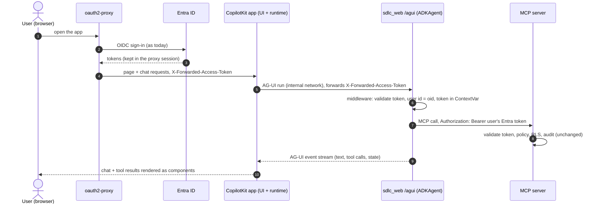
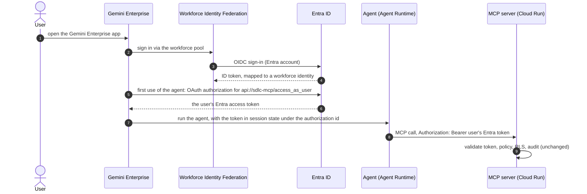

# Agentic SDLC — Implementation Plan version-01

Follows [version-00.md](version-00.md) (Stages 0–9 and the local backlog H1–H10). Architecture: [../ARCHITECTURE.md](../ARCHITECTURE.md);
database: [../DATABASE_SCHEMA.md](../DATABASE_SCHEMA.md); GCP design: [../GCP_DEPLOYMENT.md](../GCP_DEPLOYMENT.md).

## Goals

1. **More knowledge sources:** Google Cloud Storage buckets; remote git repositories on **GitHub** and
   **Bitbucket**; **Confluence** and **Jira**, each in **Atlassian Cloud and Data Center** editions.
2. **AG-UI web app:** users chat with the SDLC agents in a **CopilotKit** web app that talks to the agent over the
   **[AG-UI protocol](https://adk.dev/integrations/ag-ui/)**, signing in with their **Entra ID account** through
   oauth2-proxy as today. Every tool call still runs as the user under the same policy; MCP tool results render as UI
   (citations, entities) instead of plain text.
3. **Act on behalf of the user:** users connect their own **Confluence, Jira, GitHub and Bitbucket** accounts once;
   MCP tools then call those systems **as the user**, with the user's credential kept in **Secret Manager** and read
   only by the MCP server after the policy check. Global (service) secrets are resolved at runtime the same way.
4. **Gemini Enterprise is deferred** to a later version. Its design is kept in §6 so the AG-UI work stays compatible
   with it (both are front ends to the same agent and MCP server).

## Progress

| Milestone | Status | Notes |
|---|---|---|
| M0 — Source framework | ✅ Built (2026-10-28) | `ingest/loaders` (`sdlc_loaders`: `SourceItem`, `Loader`, registry, `local_folder`/`git` loaders, `HttpClient`), `libs/sdlc_secrets` (env + Secret Manager REST, 5-min cache), migration `004_item_metadata` (`documents.title/url`, `sync_state`), `title`/`url` in search results, `knowledge.allowed_hosts`, `spec.credentials` references. Format converters and per-type `spec` blocks come with their connectors (M1–M4) |
| M1 — Remote git (GitHub, Bitbucket) | ✅ Built (2026-10-28); live check pending tokens | `provider` (github / bitbucket-cloud / bitbucket-dc), host-scoped auth header via git's environment, branch tracking at FETCH_HEAD (fixes stale branches in the cache), incremental reads via `git diff`, deep links per provider, `SDLC_INGEST_CACHE`, `.env.sources` for the ingest container |
| M2 — GCS buckets | ✅ Built (2026-10-28); no live check | `type: gcs` (`gs://bucket/prefix/`), JSON API with ADC / service identity, downloads only changed generations, deletions from the listing, object links; Terraform `gcs_source_buckets` → `roles/storage.objectViewer` per bucket for the jobs SA |
| M3 — Confluence (Cloud + DC) | ⏳ | Spaces as sources, restricted pages excluded, attachments |
| M4 — Jira (Cloud + DC) | ⏳ | Projects/JQL as sources, issue security excluded |
| M5 — AG-UI web app (CopilotKit) | ⏳ | `/agui` endpoint in `sdlc_web`, CopilotKit UI behind oauth2-proxy; localhost + tunnel |
| M6 — User connections (on behalf of the user) | ⏳ | Per-user secret directory of PATs, Connections page, first read-only tool per product |
| M7 — GCP staging (resume Stage 7a) | ⏳ | MCP + Cloud SQL + ingest jobs + scheduling + the AG-UI app on Cloud Run + Secret Manager user secrets |
| M8 — Hardening, evals, docs | ⏳ | Version-01 exit gate |
| Deferred — Gemini Enterprise | ⏸ Later version | WIF sign-in, Agent Runtime, Gemini Enterprise authorization (§6) |

## Decisions (2026-10-17)

| Topic | Decision |
|---|---|
| Atlassian editions | **Both** Cloud and Data Center/Server: one connector per product with an `edition: cloud \| datacenter` switch |
| Access model | **Config access only**, as today: each space, project, repository or bucket prefix is a `Source` with `access` + `classification`. Native ACLs are **not** mirrored; items with native restrictions are **excluded at ingest** (§2.6) |
| GCP | **Resume in version-01**: Stage 7a staging (M7) after the AG-UI app (M5) and user connections (M6) work locally. Connectors are built and tested locally first (M0–M4) |
| User front end (2026-10-28) | **AG-UI + CopilotKit** in version-01, served by `sdlc_web` behind oauth2-proxy (Entra). adk web stays the developer UI (`/dev-ui/`). **Gemini Enterprise deferred** to a later version (§6): it needs an org admin, a workforce pool and licences, while AG-UI needs nothing beyond today's Entra setup |
| Global secrets (2026-10-28) | Config **names** a secret (`env:` or `secret:`), `libs/sdlc_secrets` resolves it at runtime (`.env` locally, Secret Manager API on GCP) with a short cache, so rotation needs no redeploy. Secrets needed at startup (DB passwords, Entra values, `groups.yaml`, `blocked.yaml`) stay Cloud Run env/file mounts (§4.2) |
| User secrets (2026-10-28) | **One Secret Manager secret per user holding a JSON directory** of that user's connections (50–100 users, ≤ 5 connections each). Read and written **only by the MCP server**, after the policy check; writes serialised per user (§4.3) |
| On-behalf access (2026-10-28) | Tools for Confluence, Jira, GitHub and Bitbucket run **as the user** with the user's own **personal access token (PAT only; no OAuth flows)**. Our policy decides whether the tool may run; the provider's native permissions then apply on top. Ingested knowledge keeps the config-only access model above. Never falls back to a service credential |
| Gemini Enterprise sign-in (deferred) | **WIF with Entra ID as OIDC provider** when it is picked up: users sign in with Entra accounts; no Google accounts to manage |
| Agent memory | Off, as assessed on the `future-assessment` branch. AG-UI conversations use the existing `SDLC_SESSION_SERVICE_URI` store and retention; no memory service |
| RAG database | Postgres-compatible on GCP (Cloud SQL, as designed in Stage 7a). Spanner stays an open option, not part of version-01 |

## 1. Source framework (M0)

The ingest pipeline today walks `local_folder` and `git` sources (`ingest/bootstrap/src/sdlc_ingest/files.py`). Version-01 turns
this into a loader interface and adds the connectors as a **new sibling component `ingest/loaders/`** (package `sdlc_loaders`,
added to the uv workspace); `ingest/bootstrap` keeps the pipeline (chunk, extract, embed, write).

- **Loader contract:** `Loader.items(cursor) -> Iterator[SourceItem]` and `Loader.all_ids() -> set[str]`.
  `SourceItem` = stable `path` (the item id: a file path, `PAY/123456`, `PAY-123`), `media_type`
  (`text/markdown`, `text/plain`, `application/pdf`), text or bytes, `content_hash`, `title`, `url` (deep link for
  citations), `updated_at`, `restricted` flag. Existing walkers become the `local_folder` and `git` loaders unchanged.
- **Formats:** Confluence storage format (XHTML) and Jira descriptions (Atlassian Document Format on Cloud, wiki markup on
  DC) are converted to Markdown so the existing Markdown chunker keeps headings. PDFs and text go through the H10 path.
- **Citations:** migration `004_item_metadata`: `documents.title` and `documents.url` (nullable). `search_knowledge` and
  `graph_query` return `url` and `title` when present, so answers can link to the Confluence page, Jira issue, or
  `github.com/<org>/<repo>/blob/<commit>/<path>#L10-L20`.
- **Incremental sync:** migration also adds `sync_state(source_id, cursor jsonb, last_synced_at)` — ingest-only, RLS forced,
  no `sdlc_app` grant. Content is fetched incrementally (updated since the cursor, changed generations, new commit);
  deletions are detected by comparing `all_ids()` with stored documents (a cheap id-only listing) on every run.
- **Credentials:** a Source names its secret, never contains it: `credentials: { env: ATLASSIAN_PAYMENTS_TOKEN }` or
  `credentials: { secret: atlassian-payments-token }` (a Secret Manager secret id). Both resolve at ingest time through
  `libs/sdlc_secrets` (§4.2), so config bundles stay secret-free. GCS uses the ingest service identity (no keys). Secrets
  never appear in logs, URLs or the database.
- **Host allowlist (SSRF guard):** `platform.yaml` `knowledge.allowed_hosts` lists the hosts sources may point at
  (`github.com`, `api.bitbucket.org`, `<site>.atlassian.net`, your DC hosts). A config change cannot make ingest call an
  arbitrary internal URL; validation fails otherwise.
- **Resilience:** pagination, 429/`Retry-After` and 5xx backoff, per-request timeouts, page-size limits; a failed item is
  reported and retried next run (as today).
- **Schema:** `config/schemas/source.schema.json` gains the new `type`s with per-type `spec` blocks (below); unknown keys fail
  validation. Every new source still needs persona-matrix `data_rows` and a CODEOWNERS rule.

## 2. Connectors

### 2.1 Remote git: GitHub and Bitbucket (M1)
```yaml
spec:
  type: git
  location: https://github.com/<org>/<repo>.git         # or https://bitbucket.org/<ws>/<repo>.git, or a DC URL
  ref: main                                            # branch (tracked) or a full SHA (pinned)
  credentials: { env: GITHUB_APP_TOKEN }               # optional for public repositories
  provider: github | bitbucket-cloud | bitbucket-dc    # deep-link format
```
- Builds on the existing `https` partial clone (`files.git_repository`). Auth via `http.extraHeader` passed in the git
  process environment (never in the URL or argv). Recommended credentials: a **GitHub App** installation token
  (read-only contents), Bitbucket Cloud **repository access token**, Bitbucket DC **HTTP access token**.
- **Branch tracking:** a branch `ref` is resolved per run and the commit recorded in `sync_state`; a SHA stays pinned
  (keep pinned refs for eval corpora such as `sdlc-platform`).

### 2.2 Google Cloud Storage (M2)
```yaml
spec:
  type: gcs
  location: gs://<bucket>/<prefix>/
  include: ["**/*.md", "**/*.pdf"]
```
- Lists objects under the prefix; uses the object **generation** (and CRC32C) to skip unchanged objects without
  downloading them. Access through the ingest service identity (`roles/storage.objectViewer` on that bucket only);
  locally through ADC.

### 2.3 Confluence (M3)
```yaml
spec:
  type: confluence
  edition: cloud | datacenter
  location: https://<site>.atlassian.net/wiki            # or the DC base URL
  space: PAY
  cql: "label = runbook"                                 # optional narrowing
  attachments: [pdf]                                     # optional: PDF attachments via the H10 path
  credentials: { env: CONFLUENCE_TOKEN }
```
- Cloud: REST v2 (`/wiki/api/v2/...`) with an API token (or OAuth 2.0 service app); DC: REST (`/rest/api/content`)
  with a personal access token. Incremental via CQL `lastmodified > cursor`; page hierarchy becomes the heading path.

### 2.4 Jira (M4)
```yaml
spec:
  type: jira
  edition: cloud | datacenter
  location: https://<site>.atlassian.net
  jql: "project = PAY AND issuetype in (Incident, Bug, Story)"
  fields: [summary, description, status, priority, components, labels, comments]
  credentials: { env: JIRA_TOKEN }
```
- One document per issue (`PAY-123`), rendered as Markdown with its fields; comments optional. Incremental via JQL
  `updated >= cursor`. Issues, components and linked issues feed the knowledge graph (entity types per source).

### 2.5 Classification and access
- Each Source keeps one classification and one `access` block. Split by sensitivity with several sources (e.g.
  `payments-confluence` internal, `payments-incidents-jira` confidential), exactly as for folders today.

### 2.6 Native restrictions (security rule)
Because access is decided by config only, content that its owners restricted inside the tool must never reach a wider
audience:
- **Confluence:** pages with view restrictions (on the page or an ancestor) are **skipped**.
- **Jira:** issues with an **issue security level** are **skipped**.
- **Private repositories / buckets:** the whole source is governed by its `access`; no per-file restrictions exist.
Skipped items are counted in the run report (never their content). A source can't opt out of this in version-01; mirroring
native ACLs remains a later option (Stage 9 `inherit_from_source`).

## 3. AG-UI web app with CopilotKit (M5)



### 3.1 Components
- **Backend:** an AG-UI endpoint (`/agui`) in `libs/sdlc_web`, built with `ag_ui_adk` (`ADKAgent` +
  `add_adk_fastapi_endpoint`) around the same `root_agent` (agent chosen by env, e.g. `SDLC_AGUI_AGENT=bootstrap`).
  It sits behind the existing `sdlc_web` middleware, so token validation, the block list and the ContextVar token path
  in `sdlc_auth.adk` are reused unchanged. adk web and its dev UI keep working next to it.
- **Frontend:** a new `ui/copilotkit/` component (Next.js + CopilotKit runtime; own Dockerfile and compose service).
  The agent port stays unpublished; oauth2-proxy routes the UI, and the CopilotKit runtime calls `/agui` server-side.
- **Generative UI:** render `search_knowledge` / `graph_query` results as citation cards (title, URL from the M0 item
  metadata, pages for PDFs) and `whoami` as an identity panel. Rendering only; no new data paths.

### 3.2 Security requirements
1. **User id = the token's `oid`.** `ADKAgent` defaults the user id to the thread id; set `user_id_extractor` to read
   the `oid` bound by the middleware for this request. A thread/session belongs to one `oid` (the same ownership check
   the middleware does for adk web sessions).
2. **The token is never stored.** Do not use `extract_headers=["authorization"]` or similar: it copies headers into
   saved session state. The token travels only in the request ContextVar. Verify that `ag_ui_adk`'s background run
   inherits the request's contextvars; if not, inject it under the `temp:` key server-side and strip it from every
   persisted event.
3. **The token never reaches browser JavaScript.** It stays in oauth2-proxy and is added by the proxy; the CopilotKit
   runtime forwards the header to `/agui` on the internal network only.
4. **Client state is untrusted.** `RunAgentInput.state` is merged into session state, so the middleware strips token
   and `temp:` keys (as it already does for `state_delta`); `allow_scoped_state_keys` stays off.
5. **Frontend tools are UI only.** CopilotKit actions defined in the browser run outside the MCP server and its
   policy, so they may only render, navigate or ask for confirmation. Anything that reads data or changes something
   is an MCP tool. Human-in-the-loop approval in the UI is UX, never authorization.
6. **No memory, persistent sessions.** `use_in_memory_services=False` with the `SDLC_SESSION_SERVICE_URI` session
   service and its retention; `save_session_to_memory_on_cleanup=False`; no memory service.
7. **Both dev paths work:** `localhost:4180` and `app-sdlc-dev` via the tunnel (both oauth2-proxy instances route the
   UI and keep their callbacks). Hostnames come from config, never hard-coded.
8. **Tracing and audit unchanged:** one agent turn is one trace; the conversation id still travels as
   `X-SDLC-Agent-Session`, so there is one MCP session per (user token, conversation).

### 3.3 Spike first
Before building the UI, confirm with a minimal `/agui` endpoint: the `ag_ui_adk` version works with our ADK 2 pin
(`google-adk>=1.28.1,<3`), contextvars reach tool calls (requirement 2), `user_id_extractor` can bind the `oid`, and
how the CopilotKit runtime forwards request headers to the AG-UI agent (requirement 3). Record the results here.

## 4. User connections and secrets (M6)

Users connect their own Confluence, Jira, GitHub and Bitbucket accounts once. MCP tools then call those systems **as the
user**, so the provider's native permissions apply on top of our policy. Agents and the model never see a credential.

### 4.1 Two kinds of secrets

| | Global | Per user |
|---|---|---|
| What | Connector tokens for ingest, Graph fallback secret | The user's personal access tokens (PATs), one per connection |
| Declared in | Source `credentials` | Nothing per user: the connection types come from `config/connections.yaml` |
| Read by | Ingest | MCP server only |
| Storage | `.env` locally; Secret Manager on GCP | One Secret Manager secret per user (§4.3); encrypted local file store in dev |

### 4.2 Global secrets: resolved at runtime
- New `libs/sdlc_secrets` with a `SecretStore` interface and backends `env` (local, CI) and `gcp` (Secret Manager API,
  global or regional secrets, service identity / ADC). Which backend is used is environment configuration
  (`SDLC_SECRETS_BACKEND=env|gcp`, `SDLC_SECRETS_PROJECT`, `SDLC_SECRETS_LOCATION`), never code: `platform.yaml` is
  shared by all environments. Built in M0.
- References: `{ env: NAME }` (today) or `{ secret: name }`. Locally the `env` backend maps `secret: atlassian-payments-token`
  to `SDLC_SECRET_ATLASSIAN_PAYMENTS_TOKEN`, so the same config works in both places. `sdlc-config validate` checks the
  form; a `--check-secrets` option (needs cloud access) to check that each secret exists is left for M7 (GCP).
- Values are cached for 5 minutes; a 401 from the downstream drops the cached value and re-reads once (picks up rotation).
- Secrets needed at startup stay Cloud Run env/file mounts: DB passwords, Entra values, `groups.yaml`, `blocked.yaml`.
- Values are wrapped in a type whose `repr` is masked; never logged, never in bundles, the DB, traces or audit.

### 4.3 Per-user secrets: one directory per user
- Secret id `sdlc-<env>-user-<h>`, where `h` = the first 32 hex characters of SHA-256(`oid`), so user ids are not
  readable from a secret listing. Label `kind=user-connections`; regional secret in the deployment region.
- Payload (latest version), keyed by connection id from `config/connections.yaml`:

  ```json
  {
    "schema": 1,
    "oid": "<entra oid>",
    "connections": {
      "jira-cloud":   {"token": "…", "username": "dev@example.com", "account": "…",
                       "expires_at": "2027-05-01", "connected_at": "2026-11-02T10:00:00Z", "verified_at": "…"},
      "bitbucket-dc": {"token": "…", "account": "…", "expires_at": null, "connected_at": "…", "verified_at": "…"}
    }
  }
  ```

  `username` only where the provider needs it with the token (Atlassian Cloud API tokens use email + token).
- The `oid` inside is checked on every read: a misnamed or swapped secret fails closed.
- PATs are read through the same 5-minute cache as global secrets, keyed by `oid`; a 401 from the provider drops the
  cached value and marks the connection `invalid` (the user reconnects).
- **Writes are rare and serialised per user:** only connect and disconnect write. Each read-modify-write holds a
  Postgres advisory lock on `h` (no table writes needed, so the read-only `sdlc_app` role is enough), re-reads the
  latest version, then adds a new version, so two quick edits from two tabs cannot lose one.
- **Version cleanup:** after a successful write, versions older than the previous one are destroyed (no old tokens
  left behind, no billed versions piling up).
- Size: five connections are a few KB, well below the 64 KiB version limit.
- **Why one secret per user** rather than one per connection: about 100 secrets instead of 500, one read per user, and
  offboarding deletes one secret. Accepted trade-offs: one read loads all of a user's tokens into the MCP process (the
  library hands a tool only the connection it declared), and Cloud Audit Logs cannot tell which connection was used
  (our audit records it). Moving to one secret per connection later only changes the `UserSecretStore` backend.
- Local dev: a `file` backend, one encrypted file per user (key `SDLC_USER_SECRETS_KEY` in `.env`) on an MCP-only
  volume. CI uses an in-memory fake.

### 4.4 Connecting an account
- **Never through chat:** a secret typed into chat reaches the model and session history. The AG-UI app gets a
  **Connections** page (connect, status, disconnect).
- The connect endpoints (`/connections/...`, a small JSON API) are served by the **MCP server**. The browser reaches
  them through oauth2-proxy (a path upstream), so the MCP server gets the user's Entra token and validates it like any
  MCP request. Agents and `sdlc_web` never handle user secrets.
- **Connect:** the page posts the PAT (and username where needed) over HTTPS. Before storing, the MCP server checks it
  with the provider's "who am I" call against the configured base URL, records the provider account and the expiry
  (from the provider where it reports one, otherwise entered by the user), then writes. The token is never echoed back:
  the page shows only connection, account, expiry and status.
- **Guidance on the page:** per connection, the recommended token type and minimum scopes (below) and a reminder to
  set an expiry. Tokens with broader scopes than needed are accepted but flagged where the provider exposes scopes.
- **Expiry:** the page and the tool's "not connected" answer warn 14 days before `expires_at`; an expired token is
  treated as not connected.
- **Disconnect:** removes the entry and writes a new version; the page reminds the user to revoke the token at the
  provider (we cannot revoke someone else's PAT for them on every product).

| Connection | Token type | Minimum scope for the first (read-only) tools |
|---|---|---|
| GitHub | Fine-grained PAT, limited to the needed repositories (classic PATs refused) | Contents: read, Metadata: read |
| Bitbucket Cloud | API token (app passwords are being retired) | Repositories: read |
| Bitbucket Data Center | HTTP access token (personal) | Repository read |
| Jira / Confluence Cloud | Atlassian API token, scoped where available, used with the account email | Read scopes for Jira work / Confluence content |
| Jira / Confluence Data Center | Personal access token | Inherits the user's permissions (no scopes): an expiry is required |

### 4.5 Using a connection in a tool
- New config kind `ConnectionCatalog` (`config/connections.yaml`): connection id, product, edition, base URL (must be in
  the host allowlist), token type, whether a username is needed, recommended scopes, maximum token lifetime.
  JSON Schema + `_KINDS` registration.
- A tool declares what it needs in `tools.yaml`: `credentials: { user: atlassian-cloud }`; validation fails for an
  unknown connection. Holding the tool is the authorization; there is no separate per-secret grant.
- Order in the MCP server: verify token → policy (deny wins, argument limits) → rate limit → load the user's connection
  → call the provider → audit. A denied call never reads the user's secret.
- Not connected, expired or revoked: the tool returns a structured "connect <name> at <url>" result (MCP URL
  elicitation where the client supports it). It **never** falls back to a service credential.
- Provider content returned by tools is untrusted (prompt injection in a Jira description): returned as data, never as
  instructions. Write tools come later and need UI confirmation (§3.2 item 5) in addition to policy.
- Audit: `tool_call` gains `connection` and `credential: user | service` and the provider status code; never token
  values. Secret Manager data-access audit logs are enabled for user secrets.
- **First tools:** one read-only tool per product (e.g. `jira_get_issue`, `confluence_get_page`, `github_get_file`,
  `bitbucket_get_file`), each with `tools.yaml` + grants + persona-matrix rows. Write tools (create issue, PR,
  comment) are a separate decision.
- CLAUDE.md security rules gain the user-credential rule when this is built ("downstream systems use the user's
  credential or a service credential only after the RBAC check passes").

### 4.6 GCP access
- MCP service account: a custom role (access, add, destroy versions; get, create, delete secrets) limited by an IAM
  condition to the `sdlc-<env>-user-` name prefix.
- Ingest service account: no access to user secrets. Agents: no Secret Manager access at all.
- Optional CMEK on user secrets; data-access audit logs on.

### 4.7 Lifecycle
- Blocked users (`blocked.yaml`) are refused by the token check at once; a reconcile job deletes their user secret.
- Expired tokens and connections unused for 90 days are removed by the same job.
- Offboarding: the job deletes the secrets of users not seen for 90 days. Users can view and remove their connections
  at any time. A PAT keeps working at the provider until it expires or is revoked there, so short expiries matter.

### 4.8 Spike first
Per provider and edition: the "who am I" endpoint, whether expiry and scopes can be read back from the token, and the
auth header form (Bearer vs Basic with email). On GCP: whether IAM conditions on the name prefix cover `secrets.create`
(otherwise a small admin job creates the user secret on first connect). Record the results here.

## 5. GCP staging (M7, resumes Stage 7a)

As designed in [../GCP_DEPLOYMENT.md](../GCP_DEPLOYMENT.md), with what changed since:
- Rebuild images (the pushed `57f55cc3ef68` images predate H1–H10); run `db` for migrations 003–004.
- Terraform additions: `blocked.yaml` as a Secret Manager file; connector secrets (Secret Manager, accessor on the jobs
  service account only); `roles/storage.objectViewer` per GCS source bucket; OTLP export to Cloud Trace;
  **Cloud Scheduler** triggering the `sdlc-ingest` job per source group (the Source `schedule` field becomes a cron).
- The `sdlc-app` service (oauth2-proxy + agent) is the user front end on GCP: it gains the CopilotKit UI container
  and serves AG-UI (§3). Local adk web stays the development surface.
- Gate: Stage 1–6 checks on staging through the MCP server (whoami, tools, skills, search, graph per persona), and
  the AG-UI gate (§7) on the staging URL.

## 6. Deferred: Gemini Enterprise with Entra sign-in

**Not part of version-01.** Kept as the design for a later version. It reuses the agent, the MCP server and the
`sdlc_auth` token path; nothing in §3 should block it. Milestone names below are placeholders (GE1–GE2).



### 6.1 Workforce Identity Federation (GE1)
- A **workforce pool** (organization-level resource; needs an org admin) with an **Entra OIDC provider**: issuer
  `https://login.microsoftonline.com/<tenant>/v2.0`, a dedicated Entra app registration for the sign-in
  (`sdlc-gcp-wif`), attribute mapping `google.subject = assertion.oid`, `google.display_name = assertion.preferred_username`,
  groups from `assertion.groups` when present.
- Terraform: `google_iam_workforce_pool` + provider, and the Entra app via the `azuread` provider (plan gap E5). Admin
  consent and app creation are tenant changes made with explicit confirmation.

### 6.2 Gemini Enterprise app (GE1)
- Create the Gemini Enterprise app with the workforce pool as its identity provider; assign licences to the pilot users.
- **Do not** connect the knowledge sources to Gemini Enterprise's own data connectors: that would bypass `Source.access`
  and RLS. Knowledge stays behind the MCP server.

### 6.3 Agents on Agent Runtime (GE2)
- New component `agents/deploy/`: wraps `agents/bootstrap` `root_agent` in `AdkApp` and creates/updates the Agent Runtime
  resource (Terraform or the `vertexai.agent_engines` API); registers the agent in the Gemini Enterprise app.
- Reused unchanged: `McpToolset` + `agent_header_provider`, `sdlc_agent.with_team_context`, the MCP server.
- **Authorization:** a Gemini Enterprise OAuth authorization (authorization-code flow) with Entra's authorize/token
  endpoints (from `platform.yaml` `identity.authority_host`), a new client registration `sdlc-gemini-enterprise` with
  Gemini Enterprise's redirect URI, scope `api://<sdlc-mcp>/access_as_user offline_access`.
- **Code change:** `libs/sdlc_auth/src/sdlc_auth/adk.py` — the session-state key becomes configurable
  (`SDLC_USER_TOKEN_STATE_KEY` = the authorization id). A callback keeps the token out of persisted session state and
  memory (tokens are never stored).
- **Sessions:** Agent Runtime managed sessions with a retention TTL; memory off.
- **Tracing/audit:** Agent Runtime traces in Cloud Trace; MCP audit in Cloud Logging; the conversation id still travels as
  `X-SDLC-Agent-Session`.

### 6.4 Enterprise gaps that become mandatory
E1 (prefer Entra **app roles** over large group claims), E4 (certificates or federated credentials where Entra supports
them; otherwise client secrets in Secret Manager with rotation), E5 (Entra apps in Terraform), E6 (no Azure CLI
pre-authorization outside dev). Group overage: configure the Graph fallback or app roles before onboarding real users.

## 7. Tests and verification

- **Unit (CI, no network):** every loader against recorded HTTP fixtures (`httpx` mock transport) for Cloud and DC
  responses: pagination, incremental cursors, deletions, 429 backoff, restricted items skipped, format conversion
  (storage XHTML / ADF / wiki markup → Markdown). GCS against a fake client; remote git against a local bare repository.
- **DB tests:** item metadata and `sync_state` under RLS (no `sdlc_app` access to `sync_state`), URLs in results.
- **Config:** host allowlist, credential references (never values), per-type spec validation, persona `data_rows`.
- **Live (manual, needs test instances):** one GitHub repo, one Bitbucket repo, one bucket, one Confluence space and one
  Jira project per edition; ingest, ask questions, check citations link to the right page/issue/line.
- **Retrieval eval:** questions per new source type added to `tests/evals/retrieval_questions.yaml`.
- **AG-UI (CI, no network):** `/agui` without a valid token is refused (401); the user id is the token's `oid`
  whatever thread id or body the client sends; a thread owned by another `oid` is refused; client state carrying token
  or `temp:` keys is stripped; persisted session events contain no token; MCP calls carry the user's token and
  `X-SDLC-Agent-Session` (FakeEntra + a stub MCP server, as in the existing `sdlc_web` tests).
- **AG-UI gate (version-01 exit):**
  1. A pilot user signs in to the CopilotKit app with their Entra account on **both** `localhost:4180` and the tunnel
     (`app-sdlc-dev`), and on the staging URL after M7.
  2. The same user gets an **identical `whoami(explain)`** and tool list in the AG-UI app, adk web and Antigravity
     (compared in the MCP audit log).
  3. Answers cite Confluence/Jira/GitHub sources by URL, rendered as citation cards; a user without access to a source
     never sees it.
  4. Session state contains no access token; a blocked user is refused within one config reload.
  5. A user connects their own Jira and GitHub PATs on the Connections page and gets answers from the first read-only
     tools; a second user whose provider account lacks access gets the provider's denial, not our data; after
     disconnect the tools answer "not connected".
- **Secrets (CI, no network):** `secret:` / `env:` references resolve through the `env` backend and fail validation when
  malformed; secret values never appear in logs, audit, traces, bundles or `repr`; the user-secret store (in-memory
  fake and the encrypted `file` backend) refuses a payload whose `oid` does not match; concurrent connects for the
  same user both survive (lock + re-read); old versions are destroyed after a write; a denied tool call never reads the
  user's secret; a missing, expired or 401-rejected PAT gives "not connected" and never a service credential; the
  connect endpoint refuses requests without a valid Entra token and never echoes the token; persona-matrix rows for each
  new tool.
- **Gemini Enterprise gate (deferred, §6):** as above, with a WIF sign-in and Gemini Enterprise added to item 2.

## 8. Prerequisites to arrange

| Needed | For | Who |
|---|---|---|
| GitHub App (or fine-grained token) and Bitbucket access tokens, read-only | M1 | Repo owners |
| A GCS bucket with sample documents | M2 | GCP project owner |
| Atlassian Cloud test site + a Confluence/Jira Data Center test instance, service accounts with tokens | M3–M4 | Atlassian admin |
| Nothing new for AG-UI: it reuses the `sdlc-client` app and both existing callbacks | M5 | — |
| Test users able to create PATs on each test instance (GitHub, Bitbucket, Atlassian Cloud and DC); PATs enabled on the DC instances | M6 | Repo owners / Atlassian admin |
| Approval to create billable GCP resources (Cloud SQL, Cloud Run, Scheduler) | M7 | You |
| GCP **organization admin** for the workforce pool; Gemini Enterprise licences | Deferred (§6) | Org admin |
| Entra admin changes: `sdlc-gcp-wif`, `sdlc-gemini-enterprise` apps, consent | Deferred (§6) | Entra admin (confirmed per change) |

## 9. Risks

- **Restricted content leaking through a broad source:** mitigated by skipping natively restricted items (§2.6) and by
  splitting sources by sensitivity; reviewed via CODEOWNERS on `config/sources/`.
- **Credentials in the ingest path:** env-referenced secrets only, never in config, bundles, logs or the database; ingest
  is the only workload with connector credentials.
- **SSRF / unexpected hosts:** host allowlist in `platform.yaml`.
- **API limits and large spaces:** incremental sync, backoff, per-source schedules.
- **AG-UI library defaults are unsafe for us:** `ag_ui_adk` defaults to in-memory sessions, a user id derived from the
  thread id, merging client state into the session, and saving sessions to memory. Each is overridden and tested (§3.2).
- **Browser-side tools bypass policy:** CopilotKit frontend actions are limited to UI work; data and actions stay MCP
  tools (§3.2 item 5), checked in review.
- **Token handling in the Node layer:** the CopilotKit runtime sees the forwarded header; it must not log it or send
  it to the browser. Covered by the spike (§3.3) and a log check in the gate.
- **Two moving client libraries** (CopilotKit, `ag_ui_adk`): pin exact versions; keep adk web as the fallback UI.
- **The MCP server holds every user's PATs:** a compromise of the MCP service exposes them. Mitigations: least-scope
  and short-lived PATs (guidance on the Connections page, expiry required on DC), IAM limited to the user-secret
  prefix, data-access audit logs, optional CMEK. If review asks for more, move user secrets behind a separate small
  credential service that re-checks the user's token (only the storage backend changes).
- **PATs outlive offboarding** at the provider until they expire or are revoked there: short expiries, deletion of our
  copy by the reconcile job (§4.7), and offboarding checklists at the provider.
- **Prompt injection through on-behalf tools:** provider content is returned as data; first tools are read-only; write
  tools need policy, UI confirmation and their own review.
- **Deferred Gemini Enterprise:** identity mismatch (WIF subject = `oid`) and org-level prerequisites (workforce pool,
  licences) move with it to the later version.
