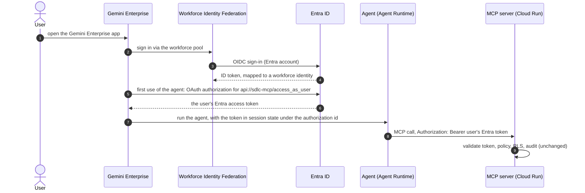

# Agentic SDLC — Implementation Plan version-01

Follows [version-0.md](version-0.md) (Stages 0–9 and the local backlog H1–H10). Architecture: [../ARCHITECTURE.md](../ARCHITECTURE.md);
database: [../DATABASE_SCHEMA.md](../DATABASE_SCHEMA.md); GCP design: [../GCP_DEPLOYMENT.md](../GCP_DEPLOYMENT.md).

## Goals

1. **More knowledge sources:** Google Cloud Storage buckets; remote git repositories on **GitHub** and
   **Bitbucket**; **Confluence** and **Jira**, each in **Atlassian Cloud and Data Center** editions.
2. **Gemini Enterprise:** users chat with the SDLC agents in a Gemini Enterprise app, signing in with their
   **Entra ID account through Workforce Identity Federation (WIF)**. The agents run in **Agent Runtime**, the MCP
   server on **Cloud Run**, and every tool call still runs as the user under the same policy as today.

## Progress

| Milestone | Status | Notes |
|---|---|---|
| M0 — Source framework | ⏳ Not started | Loader interface, item metadata (URL, title), sync state, host allowlist, credential references |
| M1 — Remote git (GitHub, Bitbucket) | ⏳ | Authenticated clones, branch tracking, deep links |
| M2 — GCS buckets | ⏳ | Object listing by generation, service-identity access |
| M3 — Confluence (Cloud + DC) | ⏳ | Spaces as sources, restricted pages excluded, attachments |
| M4 — Jira (Cloud + DC) | ⏳ | Projects/JQL as sources, issue security excluded |
| M5 — GCP staging (resume Stage 7a) | ⏳ | MCP + Cloud SQL + ingest jobs + scheduling on GCP |
| M6 — Workforce Identity Federation + Gemini Enterprise app | ⏳ | Entra OIDC provider, Gemini Enterprise app with WIF sign-in |
| M7 — Agents on Agent Runtime + authorization | ⏳ | Entra token per user via Gemini Enterprise authorization |
| M8 — Hardening, evals, docs | ⏳ | Version-01 exit gate |

## Decisions (2026-10-17)

| Topic | Decision |
|---|---|
| Atlassian editions | **Both** Cloud and Data Center/Server: one connector per product with an `edition: cloud \| datacenter` switch |
| Access model | **Config access only**, as today: each space, project, repository or bucket prefix is a `Source` with `access` + `classification`. Native ACLs are **not** mirrored; items with native restrictions are **excluded at ingest** (§2.6) |
| GCP | **Resume in version-01**: Stage 7a staging first (M5), then Gemini Enterprise (M6–M7). Connectors are built and tested locally first (M0–M4) |
| Gemini Enterprise sign-in | **WIF with Entra ID as OIDC provider**: users sign in with Entra accounts; no Google accounts to manage |
| Agent memory | Off (Agent Runtime managed sessions only), as assessed on the `future-assessment` branch |
| RAG database | Postgres-compatible on GCP (Cloud SQL, as designed in Stage 7a). Spanner stays an open option, not part of version-01 |

## 1. Source framework (M0)

The ingest pipeline today walks `local_folder` and `git` sources (`ingest/bootstrap/src/sdlc_ingest/files.py`). Version-01 turns
this into a loader interface and adds the connectors as a **new sibling component `ingest/loaders/`** (package `sdlc_loaders`,
added to the uv workspace); `ingest/bootstrap` keeps the pipeline (chunk, extract, embed, write).

- **Loader contract:** `Loader.items(cursor) -> Iterator[SourceItem]` and `Loader.all_ids() -> set[str]`.
  `SourceItem` = stable `path` (the item id: a file path, `PAY/123456`, `PAY-123`), `media_type`
  (`text/markdown`, `text/plain`, `application/pdf`), text or bytes, `content_hash`, `title`, `url` (deep link for
  citations), `updated_at`, `restricted` flag. Existing walkers become the `local_folder` and `git` loaders unchanged.
- **Formats:** Confluence storage format (XHTML) and Jira descriptions (Atlassian Document Format on Cloud, wiki markup on
  DC) are converted to Markdown so the existing Markdown chunker keeps headings. PDFs and text go through the H10 path.
- **Citations:** migration `004_item_metadata`: `documents.title` and `documents.url` (nullable). `search_knowledge` and
  `graph_query` return `url` and `title` when present, so answers can link to the Confluence page, Jira issue, or
  `github.com/<org>/<repo>/blob/<commit>/<path>#L10-L20`.
- **Incremental sync:** migration also adds `sync_state(source_id, cursor jsonb, last_synced_at)` — ingest-only, RLS forced,
  no `sdlc_app` grant. Content is fetched incrementally (updated since the cursor, changed generations, new commit);
  deletions are detected by comparing `all_ids()` with stored documents (a cheap id-only listing) on every run.
- **Credentials:** a Source names its secret, never contains it: `credentials: { env: ATLASSIAN_PAYMENTS_TOKEN }`. The value
  is read from the environment at ingest time only (`.env` locally, Secret Manager on GCP), so config bundles stay
  secret-free. GCS uses the ingest service identity (no keys). Secrets never appear in logs, URLs or the database.
- **Host allowlist (SSRF guard):** `platform.yaml` `knowledge.allowed_hosts` lists the hosts sources may point at
  (`github.com`, `api.bitbucket.org`, `<site>.atlassian.net`, your DC hosts). A config change cannot make ingest call an
  arbitrary internal URL; validation fails otherwise.
- **Resilience:** pagination, 429/`Retry-After` and 5xx backoff, per-request timeouts, page-size limits; a failed item is
  reported and retried next run (as today).
- **Schema:** `config/schemas/source.schema.json` gains the new `type`s with per-type `spec` blocks (below); unknown keys fail
  validation. Every new source still needs persona-matrix `data_rows` and a CODEOWNERS rule.

## 2. Connectors

### 2.1 Remote git: GitHub and Bitbucket (M1)
```yaml
spec:
  type: git
  location: https://github.com/<org>/<repo>.git         # or https://bitbucket.org/<ws>/<repo>.git, or a DC URL
  ref: main                                            # branch (tracked) or a full SHA (pinned)
  credentials: { env: GITHUB_APP_TOKEN }               # optional for public repositories
  provider: github | bitbucket-cloud | bitbucket-dc    # deep-link format
```
- Builds on the existing `https` partial clone (`files.git_repository`). Auth via `http.extraHeader` passed in the git
  process environment (never in the URL or argv). Recommended credentials: a **GitHub App** installation token
  (read-only contents), Bitbucket Cloud **repository access token**, Bitbucket DC **HTTP access token**.
- **Branch tracking:** a branch `ref` is resolved per run and the commit recorded in `sync_state`; a SHA stays pinned
  (keep pinned refs for eval corpora such as `sdlc-platform`).

### 2.2 Google Cloud Storage (M2)
```yaml
spec:
  type: gcs
  location: gs://<bucket>/<prefix>/
  include: ["**/*.md", "**/*.pdf"]
```
- Lists objects under the prefix; uses the object **generation** (and CRC32C) to skip unchanged objects without
  downloading them. Access through the ingest service identity (`roles/storage.objectViewer` on that bucket only);
  locally through ADC.

### 2.3 Confluence (M3)
```yaml
spec:
  type: confluence
  edition: cloud | datacenter
  location: https://<site>.atlassian.net/wiki            # or the DC base URL
  space: PAY
  cql: "label = runbook"                                 # optional narrowing
  attachments: [pdf]                                     # optional: PDF attachments via the H10 path
  credentials: { env: CONFLUENCE_TOKEN }
```
- Cloud: REST v2 (`/wiki/api/v2/...`) with an API token (or OAuth 2.0 service app); DC: REST (`/rest/api/content`)
  with a personal access token. Incremental via CQL `lastmodified > cursor`; page hierarchy becomes the heading path.

### 2.4 Jira (M4)
```yaml
spec:
  type: jira
  edition: cloud | datacenter
  location: https://<site>.atlassian.net
  jql: "project = PAY AND issuetype in (Incident, Bug, Story)"
  fields: [summary, description, status, priority, components, labels, comments]
  credentials: { env: JIRA_TOKEN }
```
- One document per issue (`PAY-123`), rendered as Markdown with its fields; comments optional. Incremental via JQL
  `updated >= cursor`. Issues, components and linked issues feed the knowledge graph (entity types per source).

### 2.5 Classification and access
- Each Source keeps one classification and one `access` block. Split by sensitivity with several sources (e.g.
  `payments-confluence` internal, `payments-incidents-jira` confidential), exactly as for folders today.

### 2.6 Native restrictions (security rule)
Because access is decided by config only, content that its owners restricted inside the tool must never reach a wider
audience:
- **Confluence:** pages with view restrictions (on the page or an ancestor) are **skipped**.
- **Jira:** issues with an **issue security level** are **skipped**.
- **Private repositories / buckets:** the whole source is governed by its `access`; no per-file restrictions exist.
Skipped items are counted in the run report (never their content). A source can't opt out of this in version-01; mirroring
native ACLs remains a later option (Stage 9 `inherit_from_source`).

## 3. GCP staging (M5, resumes Stage 7a)

As designed in [../GCP_DEPLOYMENT.md](../GCP_DEPLOYMENT.md), with what changed since:
- Rebuild images (the pushed `57f55cc3ef68` images predate H1–H10); run `db` for migrations 003–004.
- Terraform additions: `blocked.yaml` as a Secret Manager file; connector secrets (Secret Manager, accessor on the jobs
  service account only); `roles/storage.objectViewer` per GCS source bucket; OTLP export to Cloud Trace;
  **Cloud Scheduler** triggering the `sdlc-ingest` job per source group (the Source `schedule` field becomes a cron).
- The `sdlc-app` (oauth2-proxy + agent) service is optional on GCP: Gemini Enterprise replaces it for end users; local
  adk web stays the development surface.
- Gate: Stage 1–6 checks on staging through the MCP server (whoami, tools, skills, search, graph per persona).

## 4. Gemini Enterprise with Entra sign-in (M6–M7)



### 4.1 Workforce Identity Federation (M6)
- A **workforce pool** (organization-level resource; needs an org admin) with an **Entra OIDC provider**: issuer
  `https://login.microsoftonline.com/<tenant>/v2.0`, a dedicated Entra app registration for the sign-in
  (`sdlc-gcp-wif`), attribute mapping `google.subject = assertion.oid`, `google.display_name = assertion.preferred_username`,
  groups from `assertion.groups` when present.
- Terraform: `google_iam_workforce_pool` + provider, and the Entra app via the `azuread` provider (plan gap E5). Admin
  consent and app creation are tenant changes made with explicit confirmation.

### 4.2 Gemini Enterprise app (M6)
- Create the Gemini Enterprise app with the workforce pool as its identity provider; assign licences to the pilot users.
- **Do not** connect the knowledge sources to Gemini Enterprise's own data connectors: that would bypass `Source.access`
  and RLS. Knowledge stays behind the MCP server.

### 4.3 Agents on Agent Runtime (M7)
- New component `agents/deploy/`: wraps `agents/bootstrap` `root_agent` in `AdkApp` and creates/updates the Agent Runtime
  resource (Terraform or the `vertexai.agent_engines` API); registers the agent in the Gemini Enterprise app.
- Reused unchanged: `McpToolset` + `agent_header_provider`, `sdlc_agent.with_team_context`, the MCP server.
- **Authorization:** a Gemini Enterprise OAuth authorization (authorization-code flow) with Entra's authorize/token
  endpoints (from `platform.yaml` `identity.authority_host`), a new client registration `sdlc-gemini-enterprise` with
  Gemini Enterprise's redirect URI, scope `api://<sdlc-mcp>/access_as_user offline_access`.
- **Code change:** `libs/sdlc_auth/src/sdlc_auth/adk.py` — the session-state key becomes configurable
  (`SDLC_USER_TOKEN_STATE_KEY` = the authorization id). A callback keeps the token out of persisted session state and
  memory (tokens are never stored).
- **Sessions:** Agent Runtime managed sessions with a retention TTL; memory off.
- **Tracing/audit:** Agent Runtime traces in Cloud Trace; MCP audit in Cloud Logging; the conversation id still travels as
  `X-SDLC-Agent-Session`.

### 4.4 Enterprise gaps that become mandatory
E1 (prefer Entra **app roles** over large group claims), E4 (certificates or federated credentials where Entra supports
them; otherwise client secrets in Secret Manager with rotation), E5 (Entra apps in Terraform), E6 (no Azure CLI
pre-authorization outside dev). Group overage: configure the Graph fallback or app roles before onboarding real users.

## 5. Tests and verification

- **Unit (CI, no network):** every loader against recorded HTTP fixtures (`httpx` mock transport) for Cloud and DC
  responses: pagination, incremental cursors, deletions, 429 backoff, restricted items skipped, format conversion
  (storage XHTML / ADF / wiki markup → Markdown). GCS against a fake client; remote git against a local bare repository.
- **DB tests:** item metadata and `sync_state` under RLS (no `sdlc_app` access to `sync_state`), URLs in results.
- **Config:** host allowlist, credential references (never values), per-type spec validation, persona `data_rows`.
- **Live (manual, needs test instances):** one GitHub repo, one Bitbucket repo, one bucket, one Confluence space and one
  Jira project per edition; ingest, ask questions, check citations link to the right page/issue/line.
- **Retrieval eval:** questions per new source type added to `tests/evals/retrieval_questions.yaml`.
- **Gemini Enterprise gate (version-01 exit):**
  1. A pilot user signs in to Gemini Enterprise with their Entra account (WIF).
  2. The same user gets an **identical `whoami(explain)`** and tool list in Gemini Enterprise, adk web and Antigravity
     (compared in the MCP audit log).
  3. Answers cite Confluence/Jira/GitHub sources by URL; a user without access to a source never sees it.
  4. Session state contains no access token; a blocked user is refused within one config reload.

## 6. Prerequisites to arrange

| Needed | For | Who |
|---|---|---|
| GitHub App (or fine-grained token) and Bitbucket access tokens, read-only | M1 | Repo owners |
| A GCS bucket with sample documents | M2 | GCP project owner |
| Atlassian Cloud test site + a Confluence/Jira Data Center test instance, service accounts with tokens | M3–M4 | Atlassian admin |
| Approval to create billable GCP resources (Cloud SQL, Cloud Run, Scheduler) | M5 | You |
| GCP **organization admin** for the workforce pool; Gemini Enterprise licences | M6 | Org admin |
| Entra admin changes: `sdlc-gcp-wif`, `sdlc-gemini-enterprise` apps, consent | M6–M7 | Entra admin (confirmed per change) |

## 7. Risks

- **Restricted content leaking through a broad source:** mitigated by skipping natively restricted items (§2.6) and by
  splitting sources by sensitivity; reviewed via CODEOWNERS on `config/sources/`.
- **Credentials in the ingest path:** env-referenced secrets only, never in config, bundles, logs or the database; ingest
  is the only workload with connector credentials.
- **SSRF / unexpected hosts:** host allowlist in `platform.yaml`.
- **API limits and large spaces:** incremental sync, backoff, per-source schedules.
- **Identity mismatch between Gemini Enterprise and Entra:** both resolve to the same Entra user (WIF subject = `oid`;
  the OAuth authorization yields that user's token); verified in the exit gate.
- **Org-level prerequisites** (workforce pool, licences) can block M6: start the requests early.
